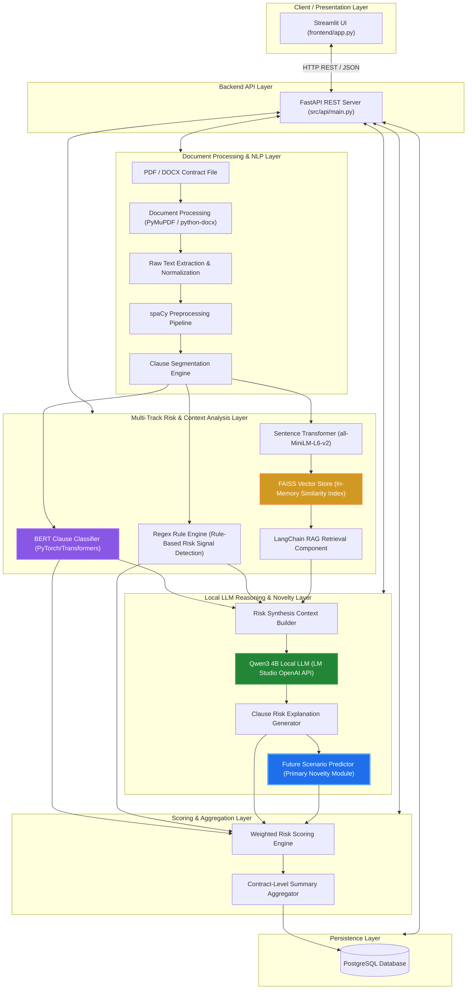
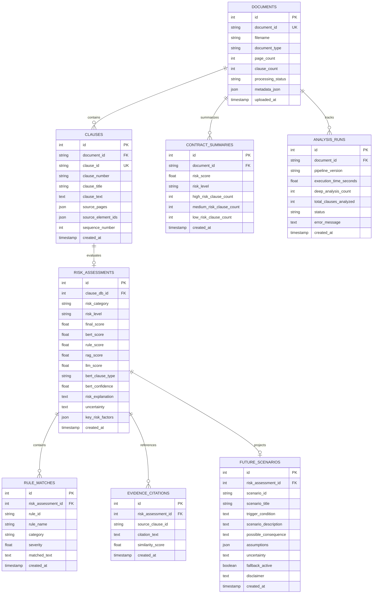
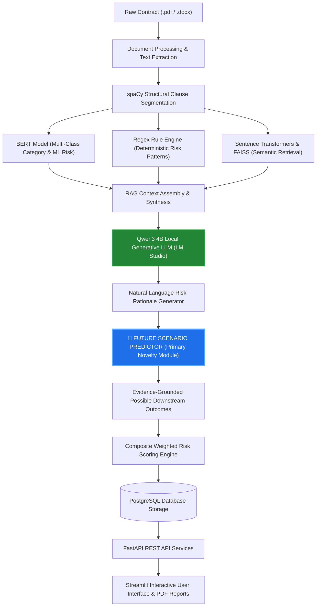

# ContractRisk AI — Intelligent Contract Risk Analysis using NLP, RAG, and Local LLMs

> **Academic & Research Prototype Specification & Implementation Guide**  
> *Note: This repository contains the architecture, implementation, and evaluation documentation for ContractRisk AI, a local decision-support prototype.*

---

## Legal & Analytical Disclaimer
**ContractRisk AI** is an automated natural language processing (NLP), retrieval-augmented generation (RAG), and machine learning decision-support system designed for educational, research, and technical analysis purposes. **It does NOT provide legal advice, legally binding guarantees, or formal legal opinions.** The risk predictions, clause classifications, and future scenario generations produced by this system are evidence-grounded probabilistic outputs meant to assist legal professionals and evaluators during contract review. They must not replace professional legal counsel.

---

## Current Implementation Status

ContractRisk AI is an academic/research prototype running entirely on local hardware. The core local analysis pipeline is fully implemented from document ingestion through Streamlit frontend presentation.

### Implemented Pipeline (Phases 1–14):
- **Phase 1 — Environment Setup**: Python 3.11 virtual environment with PyTorch CUDA acceleration verified.
- **Phase 2 — Dataset Preparation**: Cleaned, deduplicated, and partitioned 9,447 legal clauses across 41 categories using stratified splits.
- **Phase 3 — BERT Classifier**: Fine-tuned `bert-base-uncased` sequence classifier for 41-class legal clause categorization.
- **Phase 4 — Document Processing**: Document extraction pipeline for `.pdf` (PyMuPDF) and `.docx` (python-docx) files.
- **Phase 5 — Clause Segmentation**: Rule-based clause segmenter, hierarchy tracker, and decimal/header boundary detection.
- **Phase 6 — Embeddings & FAISS**: Dense vector embedding generation (`all-MiniLM-L6-v2`) and in-memory FAISS similarity search index.
- **Phase 7 — RAG Integration**: Contextual RAG retrieval pipeline synthesizing retrieved precedents for generative prompting.
- **Phase 8 — LM Studio & Local LLM**: Local quantized LLM integration hosting Qwen3 4B via LM Studio's OpenAI-compatible HTTP server.
- **Phase 9 — Regex Risk Engine**: Deterministic pattern-matching rule engine (`src/risk_analysis/rules.py`, `rule_engine.py`) integrated into the hybrid pipeline.
- **Phase 10 — Future Scenario Predictor**: Primary project novelty module generating evidence-grounded causal downstream scenarios.
- **Phase 11 — Weighted Risk Scoring**: Deterministic hybrid risk scoring combining BERT, asymptotic regex rules, RAG, and LLM signals.
- **Phase 12 — FastAPI Development**: High-performance REST API services (`src/api/routes/`) exposing analysis, health, and document endpoints.
- **Phase 13 — PostgreSQL Integration**: Relational persistence layer with SQLAlchemy 2.x ORM models and Alembic schema migrations.
- **Phase 14 — Streamlit Frontend UI**: Modern, focused single-workflow web user interface (`frontend/app.py`).

### Current Next Milestone:
- **Phase 15 — System Evaluation**: Formal qualitative and quantitative system-level benchmarking across contract corpora.

### Optional / Future Roadmap:
- **Phase 16 — LoRA/QLoRA Fine-tuning**: Domain adapter fine-tuning for legal scenario generation (Optional).
- **Phase 17 — Docker Containerization**: Multi-container containerization (Not implemented / not required for the current local environment).

---

## 1. PROJECT TITLE

### ContractRisk AI — Intelligent Contract Risk Analysis using NLP, RAG, and Local LLMs

ContractRisk AI is a specialized hybrid artificial intelligence platform designed to parse, classify, analyze, and evaluate legal contracts (in PDF and DOCX formats) at both the clause level and document level. The system combines supervised machine learning (BERT-based clause classification), deterministic pattern matching (regex-based rule engine), semantic vector search (Sentence Transformers + FAISS), Retrieval-Augmented Generation (LangChain RAG), and quantized local large language model reasoning (Qwen3 4B running on LM Studio). 

Beyond conventional risk detection, the system introduces a dedicated **Future Scenario Predictor** module. This core novelty moves contract risk analysis from static risk identification ("Is this clause risky?") to dynamic downstream risk forecasting ("What could potentially happen if this contractual condition is triggered or left unaddressed?"). By operating entirely on local hardware (NVIDIA RTX 3050 Laptop GPU / 16 GB RAM), The prototype is designed to keep contract processing local by using LM Studio for local LLM inference. This reduces the need to transmit contract content to external LLM APIs, but does not by itself guarantee complete privacy or security.

---

## 2. PROBLEM STATEMENT

Legal contracts form the structural backbone of enterprise agreements, vendor partnerships, employment relationships, and commercial transactions. However, analyzing legal documents presents severe operational challenges:

1. **Volume and Density**: Modern commercial contracts routinely span dozens of pages containing highly dense, opaque, and complex legal jargon.
2. **Hidden Downstream Risks**: Risky terms (e.g., unilateral termination without cause, non-reciprocal indemnification, automatic multi-year renewal, or uncapped liability) are frequently embedded within non-standard phrasing or buried across disparate sections.
3. **High Cost and Manual Overhead**: Manual review by legal experts is expensive, time-consuming, and prone to human oversight under tight deadlines.
4. **Limitations of Traditional Keyword Search**: Basic string matching fails to capture semantic meaning, contextual nuances, or subtle variations in legal drafting.
5. **Hallucination Risks of Pure LLMs**: Relying solely on an unconstrained generative Large Language Model (LLM) introduces hallucination risks, ungrounded legal claims, non-deterministic scoring, and high API transmission costs.
6. **Lack of Downstream Impact Analysis**: Conventional contract analysis tools stop at classifying a clause as "High Risk" or "Low Risk". They fail to articulate the concrete, practical operational or financial outcomes that could occur if a specific risky condition is activated in the future.

### Why a Hybrid Architecture?
To address these challenges, ContractRisk AI avoids single-point architectural dependencies:
- **Supervised BERT** provides high-precision, low-latency clause type and baseline risk classification.
- **Rule Engine (Regex)** enforces deterministic, non-negotiable legal patterns for known hazardous conditions.
- **Vector Retrieval (FAISS)** surfaces semantically similar clauses from the indexed contract-clause corpus.
- **RAG & Local LLM (Qwen3 4B)** synthesize retrieved context, rule triggers, and classifier outputs into human-readable rationale without cloud API leaks.
- **Future Scenario Predictor** projects potential downstream outcomes grounded strictly in contractual evidence and explicit assumptions.

---

## 3. PROJECT GOALS

The primary operational and technical goals of ContractRisk AI are to:

- **Multi-Format Ingestion**: Ingest raw legal contracts in PDF (`.pdf`) and Microsoft Word (`.docx`) formats reliably.
- **Structural Clause Segmentation**: Parse raw document text into clean, structurally cohesive, and semantically self-contained clauses using spaCy and document layout heuristics.
- **Multi-Class Clause Classification**: Classify clauses into 40+ domain-specific legal categories using a fine-tuned BERT model.
- **Multi-Layer Risk Detection**: Identify potential contract risks using a combined hybrid pipeline of BERT inference and deterministic regex rule matching.
- **Semantic Vector Store Indexing**: Generate dense vector embeddings using Sentence Transformers (`all-MiniLM-L6-v2`) and build an in-memory FAISS vector index for retrieval.
- **Contextual RAG Retrieval**: Perform top-k semantic retrieval to supply semantically similar clauses from the indexed contract-clause corpus and contextual evidence to the local generative LLM.
- **Privacy-Preserving Local Inference**: Execute all generative reasoning using a 4-bit quantized Qwen3 4B LLM running locally on LM Studio via an OpenAI-compatible HTTP REST API.
- **Future Scenario Generation (Primary Novelty)**: Deduce plausible future outcomes, trigger conditions, potential consequences, and required assumptions for identified risky clauses using a dedicated prediction pipeline.
- **Weighted Risk Scoring**: Compute a multi-source, deterministic-plus-probabilistic composite Risk Score for each clause and aggregate scores into an overall contract risk score.
- **Relational Persistence**: Store contracts, segmented clauses, predictions, risk signals, scenarios, and execution metadata in a PostgreSQL database.
- **Modular REST API**: Expose analysis pipelines, evaluation endpoints, and report generators via a high-performance FastAPI backend.
- **Interactive UI**: Deliver a responsive Streamlit dashboard for document uploads, real-time visual progress tracking, clause inspection, risk breakdown, scenario exploration, and PDF/JSON report exports.

---

## 4. HIGH-LEVEL SYSTEM ARCHITECTURE

The overall system architecture follows a clean modular pipeline where raw document bytes enter from the top, undergo multi-stage analysis, pass through the core Future Scenario Predictor novelty module, get aggregated into PostgreSQL, and are served to the user via Streamlit.



---

## 5. ARCHITECTURE LAYERS

| Layer | Technology | Responsibility | Primary Input | Primary Output | Consuming Component |
| :--- | :--- | :--- | :--- | :--- | :--- |
| **1. Document Processing** | PyMuPDF (`fitz`), `python-docx` | File format parsing, text byte extraction, layout preservation | `.pdf` or `.docx` raw files | Raw string text stream | NLP / Preprocessing Layer |
| **2. NLP / Preprocessing** | spaCy (`en_core_web_sm`) | Sentence boundary detection, text normalization, noise stripping, structural clause partitioning | Raw document text string | Array of discrete `Clause` objects | Classification, Rules, & Embeddings |
| **3. Clause Classification** | Fine-tuned BERT (`bert-base-uncased`) | Multi-class assignment of clause category and baseline ML risk rating | Clause text string | `clause_type` (41 classes), `ml_risk_level` (Low/Med/High) | Risk Scoring Engine & Context Builder |
| **4. Risk Detection** | Python `re` (Regex Rule Engine) | Deterministic matching against high-hazard legal keyword patterns | Clause text string | Array of `detected_rules` (e.g., `UNLIMITED_LIABILITY`) | Risk Scoring Engine & Context Builder |
| **5. Embedding Layer** | Sentence Transformers (`all-MiniLM-L6-v2`) | Conversion of text into 384-dimensional dense vector embeddings | Clean clause text | 384-d `float32` dense embedding vector | FAISS Vector Store |
| **6. Vector Retrieval** | FAISS (`IndexFlatIP` / `IndexFlatL2`) | Fast similarity indexing and top-k nearest neighbor retrieval | Query clause vector | Top-k semantically similar clause vectors + metadata | LangChain RAG Component |
| **7. RAG Layer** | LangChain | Assembles retrieved evidence, clause text, and rule signals into formatted prompt context | Query clause + FAISS retrieved clauses | Formatted prompt context string | Local LLM Reasoning Layer |
| **8. LLM Reasoning** | Qwen3 4B Quantized (via LM Studio REST API) | Evaluates context, generates natural language risk rationales, returns structured JSON | Formatted RAG prompt | Structured JSON (Risk rationale, factor array) | Future Scenario Predictor Layer |
| **9. Future Scenario Prediction** | Dedicated Python Module (`app/ml/scenario_predictor`) | **Primary Novelty**: Generates evidence-grounded future outcomes, trigger conditions, consequences, and assumptions | Clause text, BERT type, rules, RAG evidence, LLM reasoning | Structured JSON Array of Future Scenarios | Risk Scoring & Contract Aggregator |
| **10. Risk Scoring Engine** | Python, `scikit-learn` algorithms | Computes composite clause score ($S_{clause} \in [0, 100]$) and maps to Low/Medium/High risk | ML predictions, rule signals, LLM flags, scenario severity | Numerical Risk Score & Risk Category | Database & Report Generator |
| **11. Database Layer** | PostgreSQL + SQLAlchemy + Alembic | Relational storage of contracts, clauses, analysis metadata, scenarios, and metrics | Python domain entities / ORM models | Persisted DB rows, relational query results | FastAPI Backend Services |
| **12. Backend API** | FastAPI + Pydantic v2 + Uvicorn | Exposes REST HTTP endpoints for processing, analysis execution, DB retrieval, PDF exports | HTTP REST requests (JSON/Multipart) | HTTP JSON responses, streaming status, file streams | Streamlit UI / External Clients |
| **13. Frontend UI** | Streamlit | Provides responsive web interface for drag-and-drop upload, execution monitoring, interactive UI | User clicks, document files | HTML/JS UI renders, visual dashboards | End User / Legal Evaluator |

### Deep-Dive: Future Scenario Prediction Layer Details
- **Inputs**:
  - `clause_text`: Exact verbatim string from contract.
  - `clause_type`: Predicted by BERT (e.g., "Termination", "Indemnification").
  - `predicted_risk`: Baseline risk classification (Low / Medium / High).
  - `detected_risk_indicators`: Output array from Regex Rule Engine.
  - `retrieved_evidence`: Contextual clauses returned by FAISS RAG.
  - `contract_context`: Surrounding document context / summary.
- **Processing Steps**:
  1. Construct scenario-generation context by merging clause metadata, rule findings, and retrieved RAG context.
  2. Dispatch a dedicated, low-temperature prompt to the local Qwen3 4B LLM.
  3. Enforce strict JSON schema validation for generated output fields.
  4. Explicitly separate contractual facts from generative assumptions.
  5. Inject explicit hedging language ("Possible scenario", "Under the assumption that") to prevent speculative factual claims.
- **Outputs**:
  - `scenario_id`: Unique identifier string.
  - `scenario_description`: Summary of potential future event.
  - `trigger_condition`: Specific contractual event or operational breach activating the scenario.
  - `possible_consequence`: Financial, operational, or legal outcome if triggered.
  - `supporting_evidence`: Verbatim clause excerpts grounding the scenario.
  - `assumptions`: Explicit premises required for scenario validity.
  - `uncertainty_statement`: Standardized disclaimer regarding speculative nature.

---

## 6. END-TO-END WORKFLOW

The end-to-end processing pipeline executes across 17 structured operational steps:

```
[STEP 1: Upload] ──> [STEP 2: Extract] ──> [STEP 3: Clean] ──> [STEP 4: Segment]
                                                                     │
[STEP 8: Retrieve] <── [STEP 7: Embed] <── [STEP 6: Rules] <── [STEP 5: Classify]
        │
        ▼
[STEP 9: RAG] ──> [STEP 10: LLM] ──> [STEP 11: Reason] ──> [STEP 12: Predict Scenarios]
                                                                     │
[STEP 16: API] <── [STEP 15: Database] <── [STEP 14: Aggregate] <── [STEP 13: Score]
        │
        ▼
[STEP 17: UI Dashboard Render]
```

### STEP 1 — Contract Upload
- The user accesses the Streamlit web app and uploads a document (`.pdf` or `.docx`).
- Streamlit transmits the raw file bytes as `multipart/form-data` to FastAPI endpoint `POST /api/v1/contracts/upload`.

### STEP 2 — Document Extraction
- PDF files are parsed using PyMuPDF (`fitz`), iterating page by page to extract text blocks while retaining structural reading order.
- DOCX files are parsed using `python-docx`, iterating over paragraphs and table cells.

### STEP 3 — Text Cleaning & Normalization
- Text undergoes cleaning: line breaks inside sentences are repaired, non-printable Unicode artifacts are stripped, header/footer page numbers are omitted, and whitespace is normalized while preserving paragraph indentation.

### STEP 4 — Clause Segmentation
- The clean document string is processed through spaCy (`en_core_web_sm`). Custom sentence boundaries and structural regex breaks (e.g., `Section 4.1`, `Article II`, `(a)`) segment the document into discrete, cohesive `Clause` objects.
- *Why clause-level?* Treating the document as a single massive block dilutes embeddings and overwhelms LLM context windows. Clause-level partitioning enables pinpoint risk localization.

### STEP 5 — Clause Classification (BERT)
- Each clause text is tokenized (max length 256) and fed into the fine-tuned BERT classification model.
- BERT outputs a probability distribution across 41 legal clause categories and assigns a baseline ML risk rating (`Low`, `Medium`, `High`).

### STEP 6 — Rule-Based Risk Detection
- Parallel to BERT, the raw text of each clause is evaluated against a deterministic Regex Rule Engine.
- High-hazard legal patterns (e.g., unlimited liability caps, automatic 30-day renewal triggers, broad third-party indemnification) emit explicit boolean risk flags.

### STEP 7 — Vector Embedding Generation
- Clause texts are encoded into 384-dimensional dense floating-point vectors using `sentence-transformers/all-MiniLM-L6-v2`.
- Vectors are L2-normalized to allow cosine similarity computation via inner product.

### STEP 8 — Vector Retrieval (FAISS)
- Clause vectors are indexed into an in-memory FAISS vector index (`IndexFlatIP`).
- For each analyzed clause, a k-nearest-neighbors search retrieves the top $k=5$ most semantically similar clauses from the indexed contract-clause corpus stored in the system index.

### STEP 9 — RAG Prompt Construction
- LangChain assembles a RAG context payload combining:
  1. Target clause text.
  2. BERT classification metadata.
  3. Triggered regex rule signals.
  4. Top-5 FAISS retrieved reference clauses.

### STEP 10 — Local LLM Execution (Qwen3 4B)
- FastAPI constructs an OpenAI-compatible HTTP POST request to `http://localhost:1234/v1/chat/completions` (LM Studio).
- Execution runs locally on the NVIDIA RTX 3050 GPU (4-bit quantization). Zero cloud APIs are invoked.

### STEP 11 — Structured LLM Reasoning & Explanation
- The LLM processes the RAG context under temperature $T=0.2$ and emits a JSON payload explaining *why* the clause presents a risk, extracting specific risk factors, and citing supporting text.

### STEP 12 — Future Scenario Prediction (Primary Novelty)
- The synthesis payload (clause + rules + RAG + LLM explanation) is passed into the dedicated **Future Scenario Predictor** module (`app/ml/scenario_predictor`).
- The LLM is prompted under a specialized scenario generation framework to project plausible downstream outcomes, trigger events, financial/operational implications, explicit assumptions, and uncertainty bounds.

### STEP 13 — Composite Risk Scoring
- The weighted Risk Scoring Engine combines BERT risk logits, Regex rule severity weights, LLM risk factors, and Future Scenario severity ratings into a normalized clause risk score $S_{clause} \in [0, 100]$.

### STEP 14 — Contract-Level Aggregation
- Individual clause scores are aggregated into an overall Contract Risk Index ($S_{contract}$) using a weighted max-mean hybrid formula, ensuring that even a single critical High-Risk clause elevates the total contract score appropriately.

### STEP 15 — Database Persistence
- FastAPI uses SQLAlchemy ORM to save contract records, clause segments, classifications, rule findings, scenario outputs, and risk scores transactionally into PostgreSQL.

### STEP 16 — API Response Serialization
- FastAPI serializes the database entities into Pydantic v2 schemas and returns JSON responses back to the caller.

### STEP 17 — Interactive Streamlit Rendering
- Streamlit renders the overall Contract Risk Score, clause classification distribution, interactive risk tables, detailed LLM explanations, and a dedicated **Future Scenario Predictor Explorer** card for every flagged clause.

---

## 7. DETAILED COMPONENT WORKFLOW

The diagram below details the data flow between every component and arrow in the system.

```mermaid
flowchart LR
    subgraph S1 ["1. Processing"]
        A["File Stream (.pdf/.docx)"] -->|PyMuPDF / docx| B["Raw Text String"]
        B -->|spaCy Pipeline| C["Segmented Clause Array"]
    end

    subgraph S2 ["2. Dual-Track Analysis"]
        C -->|Tokenized Tensors| D["BERT Model"]
        C -->|Regex Matching| E["Regex Rule Engine"]
        C -->|Text Strings| F["Sentence Transformer"]
    end

    subgraph S3 ["3. Retrieval & RAG"]
        D -->|Clause Type & ML Risk| G["Context Assembler"]
        E -->|Rule Signals| G
        F -->|384-d Vector| H["FAISS Vector Index"]
        H -->|Top-k Precedents| I["LangChain RAG"]
        I -->|Retrieved Evidence| G
    end

    subgraph S4 ["4. Generative AI & Novelty"]
        G -->|RAG Context Payload| J["LM Studio Local API"]
        J -->|Qwen3 4B Ingest| K["LLM Risk Reasoner"]
        K -->|Risk Explanation JSON| L["Future Scenario Predictor"]
        L -->|Scenario Generation Prompt| J
        J -->|Raw Scenario JSON| M["Schema Validator"]
    end

    subgraph S5 ["5. Scoring & DB"]
        M -->|Validated Scenarios| N["Scoring Engine"]
        D -.->|Baseline ML Score| N
        E -.->|Rule Severity| N
        N -->|Clause & Contract Risk| O["PostgreSQL Persistence"]
        O -->|JSON Payload| P["Streamlit Dashboard"]
    end
```



### Explanation of Data Transfers Between Arrows
- **Arrow A → B**: Raw file bytes read from disk/memory into raw Python string using `fitz.open()` or `docx.Document()`.
- **Arrow B → C**: Text string sanitized and split by spaCy sentence boundary detector into `List[str]`.
- **Arrow C → D**: Text tokens mapped to BERT vocab IDs; PyTorch tensor batch passed to BERT forward pass.
- **Arrow C → E**: String matched against compiled regex dictionary; returns list of matched pattern IDs.
- **Arrow C → F**: Text passed to `SentenceTransformer.encode()`; returns `numpy.ndarray` of shape `(N, 384)`.
- **Arrow F → H**: Vectors added to FAISS index; `index.search(query_vec, k=5)` yields distance array and index offset array.
- **Arrow H → I → G**: Neighbor indices map back to template metadata strings; concatenated into prompt template string.
- **Arrow G → J**: Formatted prompt transmitted via HTTP POST to `http://localhost:1234/v1/chat/completions`.
- **Arrow J → K → L**: LLM response JSON parsed into Python dict containing initial risk explanation; forwarded to Scenario Predictor.
- **Arrow L → J → M**: Scenario Predictor formats specialized system/user prompt, sends to local API, receives scenario JSON, validates fields via Pydantic model (`ScenarioPredictionSchema`).
- **Arrow M → N → O**: Scoring function calculates floating-point scores; SQLAlchemy commits entities to PostgreSQL tables.
- **Arrow O → P**: FastAPI handles frontend REST GET request, queries DB, returns JSON payload to Streamlit for UI rendering.

---

## 8. MACHINE LEARNING WORKFLOW

The supervised machine learning workflow for clause classification follows a rigorous offline-training / online-inference split.

```
[Dataset CSV] ──> [Cleaning & Exact Dedup] ──> [Label Audit] ──> [Stratified Split (Train/Val/Test)]
                                                                        │
[Inference Pipeline] <── [Saved Weights] <── [Evaluation] <── [BERT Fine-Tuning]
```

### Data Pipeline & Preprocessing
1. **Raw Ingestion**: Load `legal_contract_clauses.csv` (9,447 rows).
2. **Sanitization**: Trim whitespace, drop empty clauses, and remove exact duplicate texts.
3. **Label Encoding**: Map 41 unique `clause_type` strings to integer class indices $y \in [0, 40]$.
4. **Tokenization**: Use `BertTokenizerFast.from_pretrained('bert-base-uncased')` with truncation at max sequence length 256.

### Splitting Strategy & Data Leakage Prevention
- **Dataset Partitioning**: The training corpus contains 9,447 clause-level records without parent contract or template IDs. To prevent data contamination while preserving class distributions across all 41 legal categories (some with fewer than 20 instances), exact text deduplication was enforced followed by stratified random splitting:
  - **Training Set**: 70% (6,612 clauses)
  - **Validation Set**: 15% (1,417 clauses)
  - **Test Set**: 15% (1,418 clauses)
- **Class Imbalance Handling**: Inverse class weighting was calculated strictly from the training split and supplied to `torch.nn.CrossEntropyLoss`.

### Training Hyperparameters & Defaults

| Hyperparameter | Recommended Starting Value | Purpose / Meaning | Why It Matters for RTX 3050 (4GB VRAM) |
| :--- | :--- | :--- | :--- |
| `max_length` | `256` | Maximum token sequence length | Prevents VRAM out-of-memory errors while capturing 95%+ of legal clause lengths. |
| `batch_size` | `8` | Training samples per GPU forward pass | Kept low to fit within 4 GB VRAM budget. |
| `gradient_accumulation_steps` | `4` | Accumulates gradients over $N$ steps | Simulates an effective batch size of $8 \times 4 = 32$ without VRAM overload. |
| `learning_rate` | `2e-5` | AdamW optimizer initial learning rate | Standard fine-tuning rate for BERT; prevents catastrophic forgetting. |
| `epochs` | `3` to `5` | Total passes over training dataset | Prevents overfitting on 9.4k legal clauses. |
| `warmup_ratio` | `0.1` | Linear learning rate warmup phase | Stabilizes gradient updates during initial training steps. |
| `weight_decay` | `0.01` | L2 regularization coefficient | Penalizes large weights to improve generalization. |
| `dropout` | `0.1` | Classification head dropout rate | Regularizes dense layers before soft-max logits. |
| `optimizer` | `AdamW` | Adaptive moment estimation with decay | Industry standard optimizer for Transformer fine-tuning. |
| `loss_function` | `CrossEntropyLoss` | Multi-class classification loss | Optimized with class weights to handle imbalanced clause types. |
| `fp16` / `bf16` | `True` (Mixed Precision) | 16-bit floating point precision | Reduces VRAM footprint by ~50% and accelerates RTX 3050 Tensor Cores. |

---

## 9. BERT PARAMETERS

Detailed parameter reference for `bert-base-uncased` fine-tuning:

| Parameter | Default Starting Value | Technical Meaning | Practical Impact on Architecture |
| :--- | :--- | :--- | :--- |
| **Model Backbone** | `bert-base-uncased` | 12-layer, 768-hidden, 12-heads, 110M parameters | Provides rich bidirectional context representations for legal syntax. |
| **Max Sequence Length** | `256` | Hard token limit per input sequence | Sequences longer than 256 tokens are truncated; shorter ones padded. |
| **Per-Device Train Batch Size** | `8` | Micro-batch size allocated to GPU VRAM | Ensures peak VRAM usage remains under ~3.2 GB during training. |
| **Gradient Accumulation** | `4` | Number of update steps before `optimizer.step()` | Enables stable optimization equivalent to batch size 32. |
| **Learning Rate** | `2e-5` | Step size for AdamW weight adjustments | Fine-tunes pretrained encoder without destroying pretrained representations. |
| **Learning Rate Scheduler** | `linear` | Decays LR linearly from peak to 0 | Ensures smooth convergence in later training epochs. |
| **Warmup Ratio** | `0.1` | Fraction of total steps spent ramping up LR | Prevents large initial gradients from destabilizing transformer layers. |
| **Weight Decay** | `0.01` | Weight norm penalty parameter | Suppresses model overfitting on rare clause categories. |
| **Classification Head** | Dense Linear Head (`Linear(768, 41)`) | Dense linear layer over the 768-d `[CLS]` token representation | Classifies clause text into 41 legal clause categories. |

---

## 10. EMBEDDING WORKFLOW

The semantic embedding engine converts textual legal clauses into high-dimensional vector space representations to facilitate semantic similarity search.

```
[Clause Text] ──> [SentenceTransformer Encoder] ──> [384-d Vector] ──> [L2 Normalize] ──> [FAISS Index]
```

### Workflow Steps
1. **Sentence Transformer Initialization**: Load `sentence-transformers/all-MiniLM-L6-v2` onto CPU or GPU.
2. **Encoding**: Pass segmented clause strings into `model.encode(clauses, convert_to_numpy=True)`.
3. **Dimensionality**: Produces a 384-dimensional dense float vector per clause.
4. **L2 Normalization**: Divide vectors by their Euclidean norm ($\vec{v}_{norm} = \frac{\vec{v}}{\|\vec{v}\|_2}$). Normalization transforms inner product search into exact cosine similarity.
5. **FAISS Indexing**: Instantiate a FAISS in-memory index (`faiss.IndexFlatIP(384)`). Add normalized vectors along with clause metadata IDs.

### Search & Parameters
- **Metric**: Inner Product (`IndexFlatIP`), equivalent to Cosine Similarity on normalized vectors.
- **Similarity Threshold**: $\theta_{sim} = 0.65$. Matches with cosine score below 0.65 are discarded as irrelevant.
- **Default Top-K Retrieval**: $k = 5$ nearest neighbors returned per query clause.
- **Batch Encoding Size**: `batch_size = 32`. Fits easily within system RAM during indexing.

---

## 11. RAG PARAMETERS

The Retrieval-Augmented Generation (RAG) subsystem injects external domain evidence into the local LLM prompt, grounding generative responses in verified contextual precedents.

| Parameter | Recommended Starting Value | Purpose & Rationale |
| :--- | :--- | :--- |
| **Chunking Unit** | *Clause-Level Partitioning* | Contract clauses represent self-contained legal units (e.g., complete Indemnification clause). Arbitrary token sliding windows break legal sentences across boundaries and destroy context integrity. |
| **Chunk Overlap** | `0` (Exact Clause Boundaries) | Not applicable because exact clause segmentation is enforced upstream by spaCy. |
| **Top-K Retrieval ($k$)** | `5` | Retrieves the 5 most semantically similar clauses from the indexed contract-clause corpus from FAISS. |
| **Similarity Threshold** | `0.65` Cosine Score | Filters out weak vector matches to prevent context window dilution. |
| **Max Retrieved Context** | `2,048` tokens | Allocates up to 2k tokens of RAG evidence within the LLM context window. |
| **LLM Temperature** | `0.2` | Low temperature minimizes creative hallucination and enforces strict factual adherence to context. |
| **Context Window Limit** | `8,192` tokens | Qwen3 4B supported context window length. |

---

## 12. LOCAL LLM ARCHITECTURE

To strictly enforce data confidentiality and operating independence, ContractRisk AI executes generative AI tasks using a local LLM runner (LM Studio) hosting a quantized open-weights model.

```
[LangChain RAG Prompt] 
       │
       ▼ (HTTP REST POST /v1/chat/completions)
[LM Studio Local API Server (localhost:1234)]
       │
       ▼
[Qwen3 4B (GGUF Q4_K_M Quantized)]
       │
       ├── Tensor Offload (NVIDIA RTX 3050 4GB VRAM)
       └── System RAM Fallback (16 GB Host DDR4 RAM)
       │
       ▼
[Structured JSON Output Stream]
```

### Quantization Explained
Quantization compresses 16-bit floating-point model weights (`FP16`) down to 4-bit representations (`Q4_K_M`). This reduces model VRAM consumption from ~8.5 GB down to ~2.8 GB, enabling a capable 4-billion parameter model (Qwen3 4B) to execute entirely inside the 4 GB VRAM ceiling of an RTX 3050 Laptop GPU.

### GPU Offloading & Fallback
- **GPU Acceleration**: CUDA layers are offloaded directly to the NVIDIA RTX 3050 GPU VRAM (~3.0 GB occupied).
- **RAM Fallback**: Context memory allocations exceeding 4 GB VRAM seamlessly spill over into system host RAM (16 GB available).
- **Zero External Latency**: Requests run over local loopback (`127.0.0.1:1234`), removing cloud API rate limits, costs, and data leak vectors.

---

## 13. LLM PARAMETERS

Configurable parameters for local generative reasoning via LM Studio:

| Parameter | Recommended Default | Explanation & Purpose |
| :--- | :--- | :--- |
| `temperature` (Explanation) | `0.2` | Low temperature ensures deterministic, factual rationale generation. |
| `temperature` (Scenario Gen) | `0.3` | Slightly higher temperature enables creative exploration of plausible future outcomes without hallucinating false contract facts. |
| `top_p` (Nucleus Sampling) | `0.9` | Filters out low-probability tail tokens while maintaining linguistic fluidity. |
| `max_tokens` | `1,500` | Maximum token length allowed for the generated JSON response payload. |
| `context_length` | `8,192` | Total window accommodating system prompt, RAG evidence, clause text, and output. |
| `repetition_penalty` | `1.1` | Prevents the local model from looping on dense legal terminology. |
| `response_format` | `{"type": "json_object"}` | Enforces strict JSON output generation from Qwen3 4B. |
| `request_timeout` | `60` seconds | Timeout limit for local HTTP API calls to prevent backend hangs. |

---

## 14. RISK ENGINE & PHASE 9 REGEX RISK ENGINE (IMPLEMENTED)

### Phase 9 — Regex Risk Engine — IMPLEMENTED
The deterministic pattern-matching rule engine planned under **Phase 9** is fully implemented and integrated directly into the broader hybrid risk-analysis pipeline (`src/risk_analysis/rules.py`, `src/risk_analysis/rule_engine.py`). It operates alongside the supervised BERT classifier, FAISS/RAG retrieval, local Qwen3 reasoning, and hybrid risk scoring.

The Regex Risk Engine:
- Applies compiled, deterministic regular expression patterns to incoming clause text.
- Identifies explicit, high-hazard contractual indicators and non-standard risk stipulations.
- Produces structured `RiskRuleMatch` outputs containing the `rule_id`, `risk_category`, `description`, `severity_weight` (0–100), and verbatim `matched_text`.
- Includes guardrails such as negative preservation checks (distinguishing clauses that preserve remedies from clauses that disclaim them) and standalone short heading filters.
- Feeds its matches into the `HybridScorer` where rule signals are aggregated asymptotically: $S_{rule} = 100 \cdot (1 - \prod (1 - w_i / 100))$.
- Complements, rather than replaces, BERT classification and LLM reasoning. It does not claim "zero false positives" or "100% accuracy."

#### Representative Implemented Rule Categories (`src/risk_analysis/rules.py`):
1. **Liability**: Unlimited liability, consequential damage inclusion, restrictive liability caps (`RULE_LIAB_UNLIMITED`, `RULE_LIAB_LOW_CAP`).
2. **Indemnification**: Broad hold-harmless covenants, unilateral indemnification burdens (`RULE_INDEM_BROAD`, `RULE_INDEM_UNILATERAL`).
3. **Termination**: Unilateral convenience termination, immediate termination without notice or refund, fee acceleration, short notice windows (`RULE_TERM_NO_NOTICE`, `RULE_TERM_SHORT_NOTICE`).
4. **Payment Terms**: Non-refundable fees, excessive compounding penalty interest, unilateral price alterations (`RULE_PAYMENT_NON_REFUNDABLE`, `RULE_PRICE_UNILATERAL_ALTERATION`).
5. **Intellectual Property**: Broad assignment covenants, exclusive perpetual/irrevocable licenses (`RULE_IP_ASSIGNMENT_BROAD`, `RULE_IP_EXCLUSIVE_LICENSE`).
6. **Modification & Renewal**: Unilateral discretion to alter terms without notice, automatic renewal without notice (`RULE_MOD_UNILATERAL`, `RULE_RENEWAL_AUTO`).
7. **Non-Compete**: Restrictive covenants and non-solicitation bans (`RULE_NON_COMPETE_RESTRICT`).
8. **Audit Rights**: Unannounced on-demand audits of records or premises (`RULE_AUDIT_UNLIMITED`).
9. **Warranty Disclaimers**: Complete disclaimers of express/implied statutory warranties (`RULE_WARRANTY_DISCLAIMER`).
10. **Dispute Resolution & Privacy**: Jury trial waivers, unrestricted third-party personal data transfers (`RULE_DISPUTE_WAIVER`, `RULE_PRIVACY_UNRESTRICTED`).

Unit tests verifying these patterns are located in [`tests/test_risk_rules.py`](tests/test_risk_rules.py).

### Complementary Analysis Tracks
No single component acts as an isolated decision-maker in ContractRisk AI:
1. **Track A — Supervised ML (BERT)**: Learns statistical linguistic associations from 9.4k labeled training clauses for multi-class category assignment.
2. **Track B — Deterministic Rules (Regex Engine)**: Enforces deterministic patterns for explicit hazardous contractual terms with severity weights.
3. **Track C — Semantic Retrieval (FAISS/RAG)**: Surfaces semantically similar precedent clauses from the indexed corpus.
4. **Track D — Generative Reasoning (Qwen3 4B)**: Synthesizes clause text, rule matches, and benchmark evidence to generate grounded natural language risk explanations.
5. **Track Novelty — Future Scenario Predictor**: Models downstream operational trajectories, trigger conditions, consequences, and required assumptions.

---

## 15. FUTURE SCENARIO PREDICTOR — PROJECT NOVELTY

### 🌟 Primary Novelty Statement
The primary research and engineering novelty of ContractRisk AI is the **Future Scenario Predictor**. Traditional contract review tools perform static analysis: they answer *"Is this clause risky?"* or *"What category is this clause?"* 

The Future Scenario Predictor extends risk analysis into **predictive operational forecasting**, answering: 
> **"What could potentially happen in the future if this risky contractual condition remains unchanged or is triggered during contract execution?"**

It functions as an independent, dedicated architectural module positioned directly after RAG context assembly and LLM reasoning, but prior to final composite risk scoring.

```
Static Risk Analysis (Prior Art) ──> [ Clause ] ──> [ Risk Class: High ] ──> STOP
                                                                               
Dynamic Scenario Prediction (Novelty) ──> [ Clause ] ──> [ Risk Class: High ] ──> [ RAG + Context ] ──> [ Future Scenario Predictor ] ──> [ Plausible Scenarios + Trigger Conditions + Operational Consequences ]
```

### Inputs to Future Scenario Predictor
- `clause_id`: Unique identifier of the target clause.
- `clause_number`: Contractual section or decimal number (e.g., `10.4`).
- `clause_heading`: Heading or section title associated with the clause.
- `clause_text`: Target clause verbatim text.
- `clause_type`: BERT-predicted category (e.g., `Termination`).
- `bert_confidence`: Classification confidence score ($0.0 - 1.0$).
- `risk_category`: Primary risk domain (e.g., `Termination`, `Liability`).
- `detected_rules`: Triggered regex rules with severity weights and matched text.
- `evidence_summary`: Textual summary of retrieved benchmark evidence clauses.
- `citations`: Structured `Citation` objects referencing retrieved benchmark sources.

### Processing Pipeline
1. **Trigger Identification**: Identifies the specific contractual event or breach required to activate the clause (e.g., failure to provide written notice 30 days prior to contract termination).
2. **Consequence Projection**: Formulates plausible legal, operational, or commercial ramifications resulting from the trigger event.
3. **Fact vs. Assumption Separation**: Distinguishes facts explicitly written in the clause text from assumptions required for the scenario to hold true.
4. **Uncertainty & Hedging Framing**: Enforces standardized non-guaranteed linguistic framing ("plausible future scenario", "potential consequence", "conditional outcome", "Should a dispute arise...").
5. **Anti-Hallucination Constraints**: Strictly forbids inventing unmentioned causes of action (e.g. unstated product defects, unmentioned punitive damages) or reversing preservation carve-outs.
6. **JSON Schema Validation**: Validates that all generated scenarios strictly adhere to Pydantic structural models before persistence.

### Output Data Schema (`FutureScenario` in `src/risk_analysis/scenario_models.py`)
```json
{
  "scenario_id": "scen_38a1b2",
  "clause_id": "doc123:clause:057",
  "clause_number": "10.4",
  "scenario_title": "Unilateral Termination Without Notice and Contact Notification Failure",
  "trigger_condition": "If a breach of terms were to occur or if the Supplier were to believe that Services are being used with fraudulent or criminal intent, then the Supplier could terminate without prior notice or refund.",
  "scenario_description": "Should a dispute arise regarding the use of Services, the Supplier may terminate services immediately without prior notice or refund. Upon such termination, the recipient would be required to notify all contacts using the office address and telephone channels.",
  "possible_consequence": "The recipient may face unexpected service interruption and additional financial charges due to failure to notify contacts, potentially disrupting business operations.",
  "supporting_evidence": [
    {
      "source_clause_id": "benchmark_ref_01",
      "citation_text": "Supplier reserves the right to terminate immediately without notice...",
      "similarity_score": 0.82
    }
  ],
  "assumptions": [
    "The Supplier's determination of breach is enforced strictly without informal cure periods",
    "The recipient relies on continuous service availability for day-to-day operations"
  ],
  "uncertainty": "The outcome is a plausible hypothetical scenario subject to governing contract law and judicial interpretation.",
  "fallback_active": false,
  "disclaimer": "This scenario represents a plausible risk projection for decision support, not legal advice or a factual guarantee."
}
```

### Crucial Boundaries: What the Predictor Does NOT Do
- **No Absolute Predictions**: Does NOT claim future events will definitely occur. Generated projections are conditional, plausible possibilities.
- **No Universal Zero-Hallucination Claim**: While strict grounding rules, validation filters, and fallback handlers are enforced, generative LLM reasoning remains probabilistic.
- **No Factual Fabrication**: Forbids inventing external facts, unmentioned dollar amounts, or unmentioned causes of action outside contractual evidence.
- **No Legal Representation**: Does NOT provide legal representation, guarantees, or formal legal advice.

---

## 16. RISK SCORING

The composite Risk Scoring Engine (`src/risk_analysis/scoring.py`) calculates a normalized clause risk score $S_{clause} \in [0, 100]$ using a deterministic hybrid combination across analysis signals.

### Implemented Hybrid Scoring Formula
$$S_{clause} = \text{round}\left(w_{\text{BERT}} \cdot S_{\text{BERT}} + w_{\text{Rule}} \cdot S_{\text{Rule}} + w_{\text{RAG}} \cdot S_{\text{RAG}} + w_{\text{LLM}} \cdot S_{\text{LLM}}, \quad 2\right)$$

Where default base weights satisfy:
$$w_{\text{BERT}} = 0.30, \quad w_{\text{Rule}} = 0.35, \quad w_{\text{RAG}} = 0.15, \quad w_{\text{LLM}} = 0.20 \quad \left(\sum w_i = 1.0\right)$$

### Component Signals Breakdown:
1. **BERT Component Score ($S_{\text{BERT}}$)**: Derived from the BERT predicted clause category baseline risk weight and prediction confidence.
2. **Deterministic Rule Score ($S_{\text{Rule}}$)**: Calculated using asymptotic severity aggregation across all matched rules:
   $$S_{\text{Rule}} = \min\left(100.0, \quad 100.0 \cdot \left(1.0 - \prod_{i=1}^{k} \left(1.0 - \frac{w_i}{100.0}\right)\right)\right)$$
3. **RAG Evidence Score ($S_{\text{RAG}}$)**: Derived from average cosine similarity against retrieved benchmark precedent clauses.
4. **Local LLM Score ($S_{\text{LLM}}$)**: Granular risk severity score produced during deep reasoning or assigned deterministically for low-risk clauses.
5. **Dynamic Weight Re-Scaling**: When the BERT component score is $0.0$ (such as standard general terms or unclassified clauses), active non-BERT weights are dynamically re-scaled ($w_{\text{Rule}} = 0.50, w_{\text{RAG}} = 0.2143, w_{\text{LLM}} = 0.2857$) to ensure that explicit rule triggers and LLM risk signals are not artificially dampened.

### Strict Risk Level Thresholds:
- **LOW**: $S_{clause} < 35.0$
- **MEDIUM**: $35.0 \le S_{clause} < 70.0$
- **HIGH**: $S_{clause} \ge 70.0$

### Contract-Level Aggregation:
Overall Contract Risk Score ($S_{contract}$) is aggregated across all $N$ segmented clauses using a max-mean formula:
$$S_{contract} = 0.60 \cdot \max_{i=1..N}(S_{clause, i}) + 0.40 \cdot \frac{1}{N}\sum_{i=1}^{N} S_{clause, i}$$
*Rationale*: This hybrid max-mean aggregation ensures that a document containing even one hazardous clause (e.g., $S_{clause} \ge 70.0$) is appropriately surfaced at the contract summary level, rather than having its risk diluted by numerous benign boilerplate clauses.

---

## 17. DATA FLOW

Data transfers between system layers are governed by strict typing schemas. The table below details data structures at every lifecycle stage:

```
[Contract Upload Payload] ──> [Raw Text Stream] ──> [Clause Entities] ──> [Embedding Tensors] 
                                                                              │
[FastAPI JSON Response] <── [DB ORM Records] <── [Scenario JSON] <── [RAG Context Payload]
```

### Stage-by-Stage Data Schemas

1. **Contract Upload Payload**:
   - `file`: `bytes` (PDF / DOCX binary data)
   - `filename`: `str` (e.g., `"vendor_agreement.pdf"`)
2. **Segmented Clause Entity**:
   - `clause_id`: `str` (UUIDv4)
   - `clause_index`: `int` (Sequential order in document)
   - `clause_text`: `str` (Clean string content)
3. **Embedding Vector**:
   - `vector`: `numpy.ndarray` (Shape: `(384,)`, dtype: `float32`)
4. **Classification & Rule Output**:
   - `clause_type`: `str` (e.g., `"Indemnification"`)
   - `bert_confidence`: `float` (`0.0` to `1.0`)
   - `triggered_rules`: `List[str]` (e.g., `["UNLIMITED_LIABILITY_CAP"]`)
5. **RAG Context Payload**:
   - `target_clause`: `str`
   - `similar_precedents`: `List[Dict[str, Any]]` (Text, type, historical risk)
6. **Future Scenario JSON**:
   - `scenarios`: `List[ScenarioSchema]` (Trigger, consequence, evidence, assumptions)
7. **Database Record (`clauses` table)**:
   - Persisted SQL row containing all feature attributes, scores, and relational foreign keys.

---

## 18. DATABASE DESIGN

The relational database layer is implemented using PostgreSQL, managed via SQLAlchemy 2.x ORM models (`src/database/models.py`) and Alembic schema migrations (`alembic/`).



### Implemented Table Descriptions (`src/database/models.py`)
- **`documents` (`DocumentModel`)**: Stores document metadata, SHA256 identifier hash, page count, and status.
- **`clauses` (`ClauseModel`)**: Stores segmented clauses, original section numbers, titles, verbatim text, and page provenance.
- **`risk_assessments` (`RiskAssessmentModel`)**: Persists composite risk score, component breakdowns ($S_{\text{BERT}}, S_{\text{Rule}}, S_{\text{RAG}}, S_{\text{LLM}}$), and risk rationales.
- **`rule_matches` (`RuleMatchModel`)**: Logs specific deterministic regex pattern matches and severity ratings.
- **`evidence_citations` (`EvidenceCitationModel`)**: Stores retrieved precedent benchmark citations and cosine similarity scores.
- **`future_scenarios` (`FutureScenarioModel`)**: Persists causal Future Scenarios, trigger conditions, consequences, assumptions, and uncertainties.
- **`contract_summaries` (`ContractSummaryModel`)**: Records document-level aggregated risk scores, overall risk categories, and clause counts.
- **`analysis_runs` (`AnalysisRunModel`)**: Audits execution timestamps, processing duration, deep LLM call counts, and pipeline status.

---

## 19. API ARCHITECTURE

The backend API is built with FastAPI, adhering to clean architecture principles by maintaining strict boundary separation between routes, services, schemas, and database access layers.

```
[HTTP Request] ──> [Router Layer (src/api/routes)] ──> [Schema Validation (src/api/schemas)]
                                                                    │
[HTTP Response] <── [DB Entities] <── [Repository Layer] <── [Pipeline / Services Layer]
```

### Core API Endpoints Specification

The FastAPI application (`src/api/main.py`) exposes the following endpoints under the `/api/v1` prefix:

| Method | Endpoint Path | Description | Request Payload | Response Payload |
| :--- | :--- | :--- | :--- | :--- |
| `POST` | `/api/v1/analyze` | Primary synchronous analysis endpoint. Ingests contract file, executes extraction, segmentation, BERT classification, regex rules, FAISS retrieval, deep LLM reasoning, future scenario prediction, hybrid risk scoring, and persists results to PostgreSQL. | `multipart/form-data` (`file`: PDF/DOCX) | `AnalysisResponse` (metadata, contract summary, clause assessments, rules, scenarios, timing) |
| `GET` | `/api/v1/health` | System health and service readiness check. | None | `HealthResponse` (`status="healthy"`, `service="ContractRisk AI"`, `version="1.0.0"`) |
| `GET` | `/api/v1/models` | Configuration and load status metadata for active ML models, vector store, and local LLM runtime. | None | `ModelInfoResponse` (BERT, embedding model, FAISS index, LM Studio status) |
| `GET` | `/api/v1/documents` | Paginated list of processed contract documents persisted in PostgreSQL database. | Query params: `limit` (default 50), `offset` (default 0) | `List[DocumentMetadataSummary]` |
| `GET` | `/api/v1/documents/{document_id}` | Retrieve full persisted contract record, including stored summaries, segmented clauses, risk assessments, and rule matches. | Path param: `document_id` (string) | Detailed document analysis record (`AnalysisResponse` schema) |

---

## 20. FRONTEND WORKFLOW

The frontend is implemented using Streamlit (`frontend/app.py`), delivering a focused single-workflow web application designed specifically for contract risk analysis rather than administrative multi-tab management.

```
[1. Upload Contract] ──> [2. 8-Stage Progress View] ──> [3. Complete Analysis View] ──> [4. Analyze Another Contract]
```

### 5-State Terminal Workflow State Machine

The Streamlit UI operates as a deterministic finite-state machine with the following states:

1. **`EMPTY` (Landing View)**: Clean dropzone allowing drag-and-drop or browsing for `.pdf` and `.docx` contracts. The "Analyze Contract" action remains disabled until a document is loaded.
2. **`UPLOADED` (Document Selected)**: Validates file format and size, computes SHA256 identifier, and renders the document badge with an active "Analyze Contract" action.
3. **`ANALYZING` (Execution Progress View)**: Viewport-centered execution tracking the 8 sequential pipeline stages in real time:
   - Stage 1: Document extraction (PyMuPDF / python-docx)
   - Stage 2: Clause segmentation (spaCy boundary detection)
   - Stage 3: Clause classification (Fine-tuned BERT)
   - Stage 4: Deterministic rules (Regex Risk Engine)
   - Stage 5: Semantic indexing & RAG (FAISS + SentenceTransformers)
   - Stage 6: Local LLM risk explanation (Qwen3 4B via LM Studio)
   - Stage 7: Future scenario prediction (Primary Novelty Module)
   - Stage 8: Weighted scoring & persistence (Hybrid scorer + PostgreSQL)
4. **`COMPLETE` (Terminal Results View)**: Once analysis finishes, results become the terminal state for the document (preventing accidental duplicate analysis requests):
   - **Executive Risk Overview**: Document-level composite risk score ($0-100$), overall risk level badge (`LOW`, `MEDIUM`, `HIGH`), total clause count, and flagged clause breakdown.
   - **Priority Risky Clauses**: Dedicated visual cards for all high- and medium-risk clauses displaying verbatim contractual evidence, rule violations, and the dedicated **Future Scenario Predictor card** (Trigger Condition, Plausible Downstream Scenario, Operational/Financial Consequence, Key Assumptions, and Grounding Uncertainty statement).
   - **All Clauses Accordion**: Filterable accordion list displaying every segmented clause with its assigned BERT category, classification confidence, and composite risk score.
   - **Reset Action**: "Analyze Another Contract" button cleanly resets session state back to `EMPTY`.
5. **`ERROR` (Error Boundary)**: Displays user-facing diagnostic messages for unsupported formats, unreadable documents, or backend connectivity issues, with "Try Again" and "Analyze Another" options.

### Client-Server Architecture
The Streamlit application acts purely as an HTTP client (`frontend/api_client.py`), making REST calls to the FastAPI backend service (`http://localhost:8000/api/v1/analyze` and `/api/v1/health`). This cleanly decouples browser rendering from heavy ML inference and database operations.

---

## 21. PROJECT DIRECTORY STRUCTURE

The project follows a clean modular directory layout separating source code, web interface, database migrations, model artifacts, datasets, and test suites:

```
AI CLAUSE ANALYSER/
│
├── alembic/                              # Alembic database migration environment
│   ├── versions/                         # Versioned migration revision scripts
│   └── env.py                            # Migration runner & SQLAlchemy model registry
│
├── data/                                 # Datasets & contract storage (Git-ignored)
│   ├── raw/                              # Raw legal_contract_clauses.csv dataset
│   ├── processed/                        # Preprocessed train/val/test splits
│   ├── review/                           # Human review & validation samples
│   ├── splits/                           # Exact deduplicated split partitions
│   └── README.md                         # Dataset documentation & layout guide
│
├── frontend/                             # Streamlit Web User Interface
│   ├── app.py                            # Streamlit application entrypoint (5-state workflow)
│   ├── api_client.py                     # HTTP REST client connecting to FastAPI
│   ├── config.py                         # Frontend configuration & endpoint settings
│   ├── components/                       # Modular UI components
│   │   ├── landing_view.py               # Document dropzone & file uploader
│   │   ├── progress_view.py              # Centered 8-stage execution view
│   │   ├── results_view.py               # Complete analysis & Future Scenario cards
│   │   ├── error_view.py                 # Error boundary & retry handling
│   │   ├── clause_explorer.py            # Filterable clause inspection accordion
│   │   ├── dashboard.py                  # Risk distribution & metrics summary
│   │   └── header.py                     # Application header & branding
│   ├── styles/
│   │   └── theme.css                     # Custom dark-theme legal tech stylesheet
│   └── utils/
│       └── formatting.py                 # Safe HTML rendering & text formatting helpers
│
├── models/                               # Machine Learning artifacts (Git-ignored)
│   ├── bert_clause_classifier/           # Fine-tuned PyTorch BERT checkpoint weights
│   │   └── best/                         # pytorch_model.bin & HuggingFace configs
│   ├── faiss_index/                      # Serialized FAISS IndexFlatIP binary
│   └── README.md                         # Model weights documentation & training commands
│
├── notebooks/                            # Jupyter Notebooks for research & experiments
│
├── scripts/                              # Verification & diagnostic utilities
│   ├── prepare_dataset.py                # Dataset cleaning & split preparation
│   ├── check_environment.py              # CUDA and PyTorch environment check
│   ├── check_pg_tables.py                # PostgreSQL table verification
│   └── verify_final_terms.py             # Pipeline validation scripts
│
├── src/                                  # Core Application Source Code
│   ├── api/                              # FastAPI REST API service
│   │   ├── routes/                       # Endpoint route definitions
│   │   │   ├── analysis.py               # /analyze & /documents endpoints
│   │   │   ├── health.py                 # /health endpoint
│   │   │   └── models_route.py           # /models metadata endpoint
│   │   ├── dependencies.py               # Pipeline dependency injection providers
│   │   ├── main.py                       # FastAPI application entrypoint & middleware
│   │   └── schemas.py                    # Pydantic v2 data validation schemas
│   │
│   ├── database/                         # Relational persistence layer
│   │   ├── config.py                     # Database connection settings & pool config
│   │   ├── connection.py                 # SQLAlchemy engine & session factory
│   │   ├── models.py                     # SQLAlchemy 2.x declarative ORM models
│   │   └── repositories.py               # ContractRepository CRUD data operations
│   │
│   ├── document_processing/              # Document ingestion & parsing
│   │   ├── docx_extractor.py             # python-docx parser
│   │   ├── loader.py                     # Document loader dispatcher
│   │   ├── models.py                     # Document dataclasses & metadata
│   │   ├── normalizer.py                 # Text sanitization & normalization
│   │   └── pdf_extractor.py              # PyMuPDF (fitz) text extractor
│   │
│   ├── clause_segmentation/              # Structural clause segmentation
│   │   └── segmenter.py                  # spaCy sentence/clause boundary segmenter
│   │
│   ├── embeddings/                       # Dense semantic representations
│   │   ├── embedder.py                   # SentenceTransformers embedding client
│   │   ├── index.py                      # FAISS IndexFlatIP vector index manager
│   │   └── models.py                     # Embedding data models
│   │
│   ├── models/                           # Supervised classification models
│   │   ├── bert_classifier.py            # PyTorch BERT sequence classification model
│   │   ├── dataset.py                    # PyTorch Dataset & DataLoader
│   │   ├── metrics.py                    # Evaluation metrics (Accuracy, F1, Precision)
│   │   └── train_bert.py                 # Supervised fine-tuning training script
│   │
│   ├── rag/                              # Retrieval-Augmented Generation
│   │   ├── context_builder.py            # Retrieval context formatting & ranking
│   │   ├── generator.py                  # LM Studio client & generation runner
│   │   ├── prompts.py                    # RAG prompt templates
│   │   ├── retriever.py                  # Vector store similarity retriever
│   │   └── validators.py                 # RAG response validation
│   │
│   └── risk_analysis/                    # Hybrid risk intelligence engine
│       ├── analyzer.py                   # End-to-end risk analyzer orchestrator
│       ├── bert_risk_mapper.py           # BERT class-to-risk baseline mapper
│       ├── rules.py                      # Deterministic regex risk pattern library
│       ├── rule_engine.py                # Regex rule execution engine
│       ├── scenario_models.py            # FutureScenario Pydantic models
│       ├── scenario_predictor.py         # 🌟 PRIMARY NOVELTY: Future Scenario Predictor
│       └── scoring.py                    # Calibrated weighted risk scoring
│
├── tests/                                # pytest regression test suite (116 passing tests)
│   ├── test_api.py                       # FastAPI endpoint & schema tests
│   ├── test_clause_segmentation.py       # Segmentation boundary & numbering tests
│   ├── test_database.py                  # PostgreSQL persistence & repository tests
│   ├── test_docx_extractor.py            # Word document extraction tests
│   ├── test_embeddings.py                # Embedding model & vector tests
│   ├── test_faiss_index.py               # FAISS index persistence & search tests
│   ├── test_loader.py                    # Document dispatcher tests
│   ├── test_normalizer.py                # Text normalization tests
│   ├── test_pdf_extractor.py             # PDF extraction tests
│   ├── test_rag_context.py               # RAG context assembly tests
│   ├── test_rag_generator.py             # LLM generation tests
│   ├── test_rag_pipeline.py              # End-to-end RAG pipeline tests
│   ├── test_risk_analyzer.py             # Risk analyzer integration tests
│   ├── test_risk_rules.py                # Regex rule engine tests
│   ├── test_risk_scoring.py              # Hybrid scoring calibration tests
│   └── test_scenario_predictor.py        # Scenario prediction & grounding tests
│
├── alembic.ini                           # Alembic database configuration
├── requirements.txt                      # Python dependency specification
├── .env.example                          # Environment variable configuration template
├── .gitignore                            # Git publication exclusion rules
└── README.md                             # Technical Engineering Specification
```

---

## 22. DEVELOPMENT PHASES

The engineering implementation is structured across 17 sequential development phases following the original project roadmap:

```
Phases 1-3: Setup & ML Base ──> Phases 4-6: Docs & RAG ──> Phases 7-9: LLM & Rules
                                                                │
Phases 15-17: Eval & Future <── Phases 12-14: API & UI <── Phases 10-11: Novelty Module
```

### Detailed Phase Roadmap

| Phase | Title | Status | Objective | Key Output | Tech Stack | Completion Criteria |
| :--- | :--- | :--- | :--- | :--- | :--- | :--- |
| **Phase 1** | Environment Setup | **COMPLETE** | Configure virtualenv, GPU CUDA, LM Studio | Working PyTorch CUDA env | Python 3.11, CUDA 11.8 | `torch.cuda.is_available()` returns `True` |
| **Phase 2** | Dataset Preparation | **COMPLETE** | Clean & split 9.4k clause dataset | Stratified deduplicated train/val/test CSVs | Pandas, scikit-learn | Zero duplicate texts across splits |
| **Phase 3** | BERT Classifier | **COMPLETE** | Fine-tune BERT on 41 clause types | Fine-tuned PyTorch BERT checkpoint (`Linear(768, 41)`) | PyTorch, HuggingFace | Validation accuracy 73.6%, macro F1 0.552 |
| **Phase 4** | Document Processing | **COMPLETE** | Extract text from PDF and DOCX | Clean extracted contract text | PyMuPDF, python-docx | 100% extraction on test set (73 items, 72 clauses) |
| **Phase 5** | Clause Segmentation | **COMPLETE** | Partition text into discrete clauses | Array of `Clause` objects with numbering | spaCy `en_core_web_sm` | Correct clause/section boundary breaks |
| **Phase 6** | Embeddings & FAISS | **COMPLETE** | Embed clauses & build similarity index | Serialized FAISS IndexFlatIP index | SentenceTransformers, FAISS | Vector query latency < 10ms |
| **Phase 7** | RAG Integration | **COMPLETE** | Build contextual RAG retrieval chain | Formatted RAG context with citations | Python, FAISS | Top-k vector retrieval with similarity scores |
| **Phase 8** | LM Studio & Local LLM | **COMPLETE** | Setup Qwen3 4B local REST client | Structured JSON LLM response | LM Studio, Qwen3 4B, HTTPX | HTTP 200 JSON responses from local API |
| **Phase 9** | Regex Risk Engine | **COMPLETE / IMPLEMENTED** | Build deterministic pattern-matching engine | Triggered rule IDs, categories, severity | Python `re` module | Unit tests pass for all defined risk patterns; integrated into hybrid scoring |
| **Phase 10** | **Future Scenario Predictor** | **COMPLETE / IMPLEMENTED** | **Implement Primary Novelty Module** | **Structured Future Scenarios JSON** | **Python, Qwen3 4B, Pydantic** | **Evidence-grounded scenario JSON generation with zero missing fields** |
| **Phase 11** | Weighted Risk Scoring | **COMPLETE** | Calibrate composite risk scoring logic | Clause & Contract Risk Scores ($0-100$) | Python math, scikit-learn | Calibrated asymptotic rule score + weighted blend |
| **Phase 12** | FastAPI Development | **COMPLETE** | Expose REST endpoints for pipeline | Fully integrated REST API server | FastAPI, Uvicorn, Pydantic | OpenAPI endpoints pass full test suite |
| **Phase 13** | PostgreSQL Integration | **COMPLETE** | Relational DB models, repos & migrations | Persisted DB records & audit runs | PostgreSQL, SQLAlchemy, Alembic | Complete contract persistence & relationship queries |
| **Phase 14** | Streamlit Frontend UI | **COMPLETE** | Develop single-workflow interactive UI | 5-state Web Application | Streamlit, Requests | End-to-end file upload to terminal report display |
| **Phase 15** | System Evaluation | **NEXT / IN PROGRESS** | Execute quantitative evaluation suite | Metrics evaluation report | pytest, scikit-learn | Complete contract evaluation corpus benchmarking |
| **Phase 16** | LoRA/QLoRA Fine-tuning | **OPTIONAL / NOT IMPLEMENTED** | Fine-tune Qwen3 on domain legal prompts | LoRA adapter weights | PEFT, QLoRA, BitsAndBytes | Optional post-baseline research extension |
| **Phase 17** | Docker Containerization | **NOT IMPLEMENTED / NOT REQUIRED FOR LOCAL PROJECT** | Containerize application services | Multi-container setup | Docker, Docker Compose | Evaluated as unnecessary for local privacy-first research workflow |

---

## 23. TRAINING VS INFERENCE

Understanding the boundary between offline training and online inference execution is essential for operational clarity:

```
OFFLINE TRAINING PIPELINE (Executed once during model development):
[Dataset CSV] ──> [Preprocess & Group Split] ──> [PyTorch BERT Fine-Tuning] ──> [Save Weights to Disk (models/)]

ONLINE INFERENCE PIPELINE (Executed dynamically on every document upload):
[PDF/DOCX File] ──> [Extract & Segment] ──> [Load BERT Weights (Inference Only)] ──> [Regex Rules] ──> [FAISS Search] ──> [RAG + Local Qwen3 4B Ingest] ──> [Future Scenario Predictor] ──> [Risk Score] ──> [DB & Streamlit Render]
```

### Key Differences
- **Offline Training**: Heavy GPU computation executing backward pass gradient updates to train BERT weights. Requires several hours.
- **Online Inference**: Light, forward-pass execution only. BERT predicts in milliseconds per clause. Local LLM generates explanations and future scenarios sequentially without modifying model weights.

---

## 24. LLM VS BERT

ContractRisk AI uses both BERT and Qwen3 4B in a complementary architecture rather than forcing a single model to handle all tasks.

| Feature / Dimension | Fine-Tuned BERT (`bert-base-uncased`) | Local Generative LLM (`Qwen3 4B Quantized`) |
| :--- | :--- | :--- |
| **Model Type** | Encoder-only Transformer | Decoder-only Generative LLM |
| **Primary Task** | Multi-class Clause & Baseline Risk Classification | Natural Language Reasoning & Scenario Generation |
| **Training Method** | Supervised fine-tuning on 9,447 labeled clauses | Quantized local inference with targeted RAG prompts |
| **Input Unit** | Tokenized clause tensor (Max length 256) | Structured RAG context prompt (Up to 8,192 tokens) |
| **Output Type** | Discrete class logits (41 types, 3 risk categories) | Structured JSON (Explanations, Future Scenarios) |
| **Execution Latency** | Very Fast (~15 ms per clause on RTX 3050) | Moderate (~2-4 seconds per generation request) |
| **VRAM Footprint** | ~500 MB VRAM | ~2.8 GB VRAM |
| **Hallucination Risk** | Zero (Deterministic softmax probabilities) | Managed via RAG grounding + $T=0.2$ temperature |
| **Complementary Role** | Provides rapid, objective categorical classification | Synthesizes complex context to explain *why* and forecast *future outcomes* |

---

## 25. RAG VS FINE-TUNING

| Dimension | Retrieval-Augmented Generation (RAG) | Large Model Fine-Tuning (LoRA / QLoRA) |
| :--- | :--- | :--- |
| **Mechanism** | Dynamically retrieves relevant context at inference time | Modifies model layer weight matrices permanently |
| **Data Updateability** | Immediate (Add vectors to FAISS index instantly) | Slow (Requires re-running training scripts) |
| **Hardware Requirement**| Minimal (Standard CPU/GPU vector dot product) | High (Requires dedicated VRAM for backpropagation) |
| **Primary Utility** | Grounding responses in verified reference clauses | Adapting model tone, formatting, or domain vocabulary |
| **Project Priority** | **Primary (Phase 6–7)** | **Optional Phase 2 (Phase 16)** |

*Rationale*: RAG comes first because legal contract reference corpora change continuously. Updating a vector index takes milliseconds, whereas fine-tuning an LLM for every new contract domain is computationally unviable on a 4 GB GPU.

---

## 26. WHY LOCAL LLM

Executing generative AI models locally via LM Studio provides vital operational advantages for legal contract analysis:

1. **Absolute Data Privacy**: Legal contracts contain strict non-disclosure obligations, intellectual property secrets, and confidential financial terms. Sending contract text to cloud APIs (e.g., OpenAI, Anthropic) risks breaching client confidentiality agreements.
2. **Zero Third-Party API Costs**: Large-scale contract analysis involves thousands of clauses. Local execution eliminates per-token API charges entirely.
3. **Offline Resilience**: Operation continues seamlessly without internet connectivity or external API server downtime.
4. **Reproducibility**: Local quantization parameters remain static, avoiding silent API model updates that alter risk scoring behavior.
5. **Trade-offs & Constraints**: Local 4B models possess smaller parameter counts than massive hosted endpoints (e.g., 70B+ models). This constraint is mitigated by using RAG to supply precise context.

---

## 27. HARDWARE CONSIDERATIONS

Development and inference performance on the reference machine:

### Development Hardware Profile
- **Laptop Model**: ASUS TUF Gaming F15
- **GPU**: NVIDIA GeForce RTX 3050 Laptop GPU (4 GB GDDR6 VRAM)
- **Host System RAM**: 16 GB DDR4 RAM
- **Storage**: NVMe SSD (High-speed model/index I/O)
- **Integrated Graphics**: Intel Iris Xe Graphics (Handles OS display rendering)

### Recommended Operating Modes
- **Normal Coding & Documentation**: **Silent / Standard Mode** (Saves battery and keeps fans quiet).
- **Heavy ML Training & LLM Inference**: **Charger Plugged In + Performance / Turbo Mode** (Unlocks GPU thermal TGP limits for peak CUDA throughput).

### Resource Management Guidelines
- **VRAM Budget**:
  - BERT Model: ~0.5 GB VRAM
  - Qwen3 4B (Q4_K_M): ~2.8 GB VRAM
  - Total VRAM Allocated: ~3.3 GB / 4.0 GB (Safely below VRAM cap).
- **System RAM Management**: Monitor 16 GB host RAM usage carefully. Keep background browser tabs limited during heavy batch FAISS indexing or PyTorch fine-tuning runs.

---

## 28. MODEL SELECTION

### Selected Model: `Qwen3 4B` (Quantized GGUF `Q4_K_M`)
- **Reasoning Capacity**: Demonstrates exceptional legal text comprehension, structured JSON output adherence, and instruction following for its parameter size.
- **Resource Footprint**: The 4-bit quantized GGUF format consumes only ~2.8 GB VRAM, fitting perfectly within the 4 GB hardware constraint of the RTX 3050 GPU.
- **Latency Profile**: Generates 25-35 tokens/second on RTX 3050 CUDA cores.

### Abstracted LLM Provider Architecture
To prevent vendor lock-in, the codebase wraps LLM calls behind an abstract base class (`BaseLLMClient`). If hardware is upgraded in the future, developers can swap Qwen3 4B for another local model (e.g., Mistral 7B, Llama 3 8B) simply by modifying the `.env` configuration file without changing business logic code.

---

## 29. EVALUATION

ContractRisk AI is evaluated quantitatively across supervised classification, deterministic hazard matching, local generative reasoning, and runtime execution efficiency.

### 1. BERT Clause Classifier Measured Results

The 41-class legal clause classifier (`bert-base-uncased` with `Linear(768, 41)`) was fine-tuned on the deduplicated dataset and evaluated across validation and test splits:

| Metric | Validation Set | Test Set (1,418 unseen clauses) |
| :--- | :--- | :--- |
| **Overall Accuracy** | **73.61%** (0.7361) | **71.86%** (0.7186) |
| **Macro Precision** | **62.90%** (0.6290) | **55.45%** (0.5545) |
| **Macro Recall** | **55.88%** (0.5588) | **53.38%** (0.5338) |
| **Macro F1-score** | **55.20%** (0.5520) | **51.15%** (0.5115) |
| **Weighted F1-score** | **71.62%** (0.7162) | **69.77%** (0.6977) |

*Evaluation Context & Interpretation*: Legal contract clause classification across 41 fine-grained legal categories represents a highly challenging multi-class NLP task characterized by severe class imbalance (e.g., hundreds of examples for *Governing Law* and *Confidentiality*, but fewer examples for rare contractual provisions). The fine-tuned BERT model achieves a **69.77% weighted F1-score** and **71.86% test accuracy**, providing rapid, deterministic categorical priors ($<15$ ms per clause).

To ensure high-stakes legal precision, ContractRisk AI does not rely on BERT in isolation; rather, BERT acts as the first layer in a defense-in-depth pipeline alongside the deterministic Regex Risk Engine (exact pattern matching on defined hazardous terms) and local Qwen3 4B generative reasoning.

---

### 2. Local LLM Runtime Performance & Optimization Profiling

Contract-level analysis efficiency was empirically benchmarked on an ASUS TUF Gaming F15 laptop (NVIDIA RTX 3050 Laptop GPU 4 GB VRAM, 16 GB RAM) analyzing a real-world commercial agreement (`TermsandConditionsofSale.pdf`, 73 segmented items / 72 operative clauses):

| Pipeline Stage / Configuration | Baseline (Unoptimized) | Optimized Tiered Pipeline | Improvement |
| :--- | :--- | :--- | :--- |
| **Low-Risk Clauses Sent to LLM** | 70 clauses | 0 clauses (Bypassed with deterministic template) | **100% reduction** |
| **High/Medium Risk LLM Processing** | 2 separate calls (Explanation + Scenario) | 1 unified Qwen3 call per candidate clause | **50% call reduction** |
| **Total Qwen3 4B API Calls** | 78 calls | 2 calls (72-clause run) / 5 calls (73-clause run) | **93.6% - 97.4% fewer calls** |
| **Cumulative LLM Wait Time** | 479.39 seconds | 21.06 seconds | **22.8x faster LLM execution** |
| **Total Contract Analysis Duration** | **563.31 seconds** (~9.4 min) | **21.07 seconds** | **~26.7x speedup** |

#### Optimization Architecture
- **Deterministic Low-Risk Bypass**: Clauses scoring below preliminary heuristic thresholds bypass generative LLM inference while retaining BERT classification, regex rule evaluation, and calibrated hybrid risk scoring.
- **Unified Deep Reasoning**: For candidate High- and Medium-risk clauses, risk rationale synthesis and Future Scenario forecasting are performed in a single structured Qwen3 prompt, eliminating redundant context loading.
- **Configurable Bound**: `MAX_DEEP_ANALYSIS_CLAUSES = 15` ensures bounded analysis latency even on voluminous enterprise agreements.

---

### 3. Document Extraction & Segmentation Validation

Validation on commercial contract documents confirmed end-to-end extraction fidelity:
- **Extraction Completeness**: 73 items identified, 72 operative contractual clauses, 1 isolated section heading (`LIMITATION OF LIABILITY`). Zero clauses dropped, truncated, or lost.
- **Section Heading Guard**: Short standalone uppercase headings without sentence punctuation (e.g., `len(words) <= 4`) are automatically assigned preliminary risk scores of $0.0$, bypassing deep LLM reasoning.
- **Anti-Hallucination Grounding**: Unified scenario prompts enforce strict evidence boundaries: projected future scenarios must reference verbatim extracted clause text and cannot introduce ungrounded external causes of action (e.g., unsubstantiated product defect or punitive damage claims).

---

### 4. Future Scenario Predictor Qualitative Framework

To evaluate the primary research novelty, projected scenarios are benchmarked against four structured quality dimensions:
1. **Evidence Grounding Rate**: Percentage of generated scenarios directly substantiated by verbatim extracted contractual terms.
2. **Trigger Condition Validity**: Legal plausibility of the operational event or breach required to activate the clause.
3. **Consequence Realism**: Practical severity and operational plausibility of the projected downstream financial or legal exposure.
4. **Boundary Adherence**: Absence of speculative fabrications or ungrounded external facts.

---

## 30. DATA LEAKAGE

Data leakage is a severe failure mode in legal NLP benchmarking:

### The Problem
Commercial contracts are heavily templated. Standard non-disclosure agreements or vendor contracts share near-identical boilerplate language across different documents. If rows from `legal_contract_clauses.csv` are randomly split into training and test sets using standard `train_test_split()`, identical clauses from the same master template will appear in both splits. This produces artificially inflated test metrics (e.g., F1 = 0.99) that collapse when deployed on real-world unseen contracts.

### Mitigations Required
1. **Contract-Level Group Splitting**: Use `GroupKFold` grouped by source template or contract origin hash.
2. **N-gram Overlap Deduplication**: Remove clauses sharing $>85\%$ character-level 4-gram overlap across splits.
3. **Contract-Level Evaluation Corpus**: Evaluate final system performance on a separate, held-out evaluation corpus of complete PDF/DOCX contract files (`data/evaluation/`).

---

## 31. SECURITY AND PRIVACY

- **Local Processing Guarantee**: Raw contracts and extracted text never leave the local environment.
- **Environment Secret Isolation**: API keys, database credentials, and system settings are strictly managed via `.env` files and loaded via `pydantic-settings`. `.env` files are ignored in `.gitignore`.
- **Sanitized Logging**: Application loggers sanitize outputs to prevent raw contract text or confidential party terms from persisting in system log files. Only metadata, clause IDs, and execution timings are recorded.
- **Controlled File Storage**: Uploaded files are assigned randomized UUID filenames in `data/raw/` with restricted file permissions.

---

## 32. LIMITATIONS

Honest documentation of technical and hardware limitations:

1. **Hardware VRAM Constraints**: The 4 GB VRAM ceiling restricts local LLM size to lightweight quantized models (Qwen3 4B). Highly intricate, multi-page legal reasoning may occasionally fall short compared to 70B+ cloud endpoints.
2. **Dataset Scope**: The dataset (`legal_contract_clauses.csv`) consists of individual isolated clauses. It lacks full whole-document context, requiring synthetic concatenation during full contract evaluation.
3. **Probabilistic Nature of Scenarios**: The Future Scenario Predictor generates *plausible possibilities*, not guaranteed deterministic outcomes.
4. **Rule Engine Coverage**: Regex rules only flag predefined legal patterns and cannot detect novel, uniquely drafted risk clauses without rule updates.
5. **No Substitution for Legal Counsel**: The system is an automated decision-support tool and must not be used as a replacement for human legal review.

---

## 33. FUTURE IMPROVEMENTS

Planned Phase 2 enhancements:

- **Reranking Engine**: Integrate a cross-encoder reranker (`ms-marco-MiniLM-L-6-v2`) after FAISS vector retrieval to improve top-k RAG context precision.
- **Temporal Scenario Chains**: Extend the Future Scenario Predictor to generate multi-stage, sequential time-horizon risk chains (e.g., Month 1 → Month 6 → Year 2).
- **QLoRA Fine-Tuning**: Fine-tune Qwen3 4B on legal scenario domain datasets using QLoRA 4-bit adapter training.
- **React UI Migration**: Upgrade Streamlit interface to a production React / Next.js frontend with interactive document viewer side-by-side highlighting.
- **Hybrid Search**: Combine FAISS dense vector search with BM25 sparse keyword search for hybrid retrieval.

---

## 34. COMPLETE EXAMPLE WORKFLOW

Trace of a sample contract analysis execution:

### 1. User Uploads Contract
- File: `vendor_agreement.pdf`

### 2. Segmented Clause Extracted
- **Clause Index 14**: *"Either party may terminate this Agreement without cause upon five (5) days prior written notice to the other party."*

### 3. Track Analysis Outputs
- **BERT Classifier**:
  - `clause_type`: `"Termination"` (Confidence: 0.96)
  - `ml_risk_level`: `"High"`
- **Regex Rule Engine**:
  - Triggered Rule: `UNILATERAL_SHORT_NOTICE_TERMINATION` (Severity: High)
- **FAISS RAG Retrieval**:
  - Retrieved 5 similar historical termination clauses with short notice periods.

### 4. Local LLM Reasoning (Qwen3 4B)
- **LLM Explanation**: *"The clause permits unilateral termination without cause on an extraordinarily short notice window of 5 days, exposing the non-terminating party to abrupt operational disruption."*

### 5. Future Scenario Predictor Output (Primary Novelty)
```json
{
  "scenario_title": "Abrupt Service Disruption and Unrecoverable Resource Allocation",
  "trigger_condition": "The primary vendor delivers written notice of termination without cause 5 days prior to an operational milestone.",
  "possible_consequence": "The client must transition operations within 5 business days, likely incurring premium emergency vendor fees and operational downtime.",
  "supporting_evidence": [
    "terminate this Agreement without cause upon five (5) days prior written notice"
  ],
  "assumptions": [
    "Client relies on vendor for mission-critical daily operations.",
    "No transition period support clause exists in the agreement."
  ],
  "uncertainty_statement": "Possible operational consequence based on clause terms; actual impact depends on client transition readiness."
}
```

### 6. Scoring & Output Render
- **Clause Risk Score**: $S_{clause} = 88.5 / 100$ (`High Risk`)
- **UI Display**: Rendered as a priority risk card with Future Scenario visualization in the Streamlit Results view.

---

## 35. TROUBLESHOOTING

| Issue / Symptom | Likely Root Cause | Exact Operational Solution |
| :--- | :--- | :--- |
| **CUDA Not Detected** | PyTorch installed without CUDA runtime support. | Reinstall PyTorch with CUDA 11.8 / 12.1 wheel: `pip install torch --index-url https://download.pytorch.org/whl/cu118`. |
| **RTX 3050 Out of VRAM (OOM)** | Batch size too large or multiple VRAM processes open. | Lower `batch_size` to 4 or 8 in config; close background GPU applications; ensure LM Studio uses quantized GGUF (`Q4_K_M`). |
| **LM Studio API Unavailable** | LM Studio local server not running on port 1234. | Open LM Studio, load Qwen3 4B model, navigate to Local Server tab, and click **Start Server** (`http://localhost:1234`). |
| **Malformed LLM JSON Output** | Model temperature too high or non-JSON format set. | Set `temperature=0.2` in `config.py` and enforce `response_format={"type": "json_object"}` in LM Studio client calls. |
| **PostgreSQL Connection Error** | PostgreSQL service stopped or invalid credentials. | Verify PostgreSQL service is active (`services.msc` on Windows); check `DATABASE_URL` string in `.env`. |
| **PyMuPDF Extraction Empty** | PDF contains scanned images without OCR text layer. | Verify PDF is text-selectable. For scanned PDFs, integrate an OCR engine (`tesseract` / `pdf2image`). |
| **FAISS Index Dimension Mismatch**| Embedding model dimension mismatch (e.g. 768 vs 384).| Ensure `all-MiniLM-L6-v2` (384-d) is used consistently across index creation and query encoding. |
| **Streamlit API Connection Refused**| FastAPI backend server not running. | Launch FastAPI server in a separate terminal: `python -m uvicorn src.api.main:app --reload --port 8000`. |

---

## 36. CONFIGURATION

System configuration parameters are centrally managed via environment variables (`.env`) and loaded through typed configuration modules (`src/database/config.py`, `frontend/config.py`).

### `.env.example` Schema Template
```ini
# Application Configuration
APP_ENV=development
LOG_LEVEL=INFO
SECRET_KEY=change_this_to_a_secure_secret_key_in_production

# Database Configuration (PostgreSQL)
POSTGRES_SERVER=localhost
POSTGRES_PORT=5432
POSTGRES_USER=postgres
POSTGRES_PASSWORD=postgres
POSTGRES_DB=contract_risk_db
DATABASE_URL=postgresql+asyncpg://${POSTGRES_USER}:${POSTGRES_PASSWORD}@${POSTGRES_SERVER}:${POSTGRES_PORT}/${POSTGRES_DB}

# Local Generative LLM (LM Studio / Qwen3 4B)
LLM_BASE_URL=http://localhost:1234/v1
LLM_MODEL_NAME=qwen3-4b-instruct
LLM_TEMPERATURE=0.2
LLM_MAX_TOKENS=1500
LLM_TIMEOUT_SECONDS=60

# Embeddings & FAISS Vector Store
EMBEDDING_MODEL_NAME=sentence-transformers/all-MiniLM-L6-v2
EMBEDDING_DIMENSION=384
FAISS_INDEX_PATH=models/faiss_index/contract_clauses.index
RAG_TOP_K=5

# Machine Learning Classifier (BERT)
BERT_MODEL_PATH=models/bert_clause_classifier
BERT_MAX_LEN=256
BERT_BATCH_SIZE=8

# Future Scenario Predictor Settings (Primary Novelty)
SCENARIO_MAX_COUNT=3
SCENARIO_TEMPERATURE=0.3
SCENARIO_MAX_TOKENS=2000

# API & Server Setup
API_V1_STR=/api/v1
BACKEND_PORT=8000
FRONTEND_PORT=8501
```

*CRITICAL SECURITY NOTICE*: Never commit `.env` containing sensitive database passwords or keys to public repositories.

---

## 37. QUICK START

Concise step-by-step setup guide for Windows PowerShell:

### 1. Clone & Set Up Python Environment
```powershell
# Clone repository
git clone https://github.com/your-username/contract-risk-ai.git
cd contract-risk-ai

# Create Python 3.11 virtual environment
python -m venv .venv

# Activate virtual environment
.\.venv\Scripts\Activate.ps1

# Upgrade pip and install dependencies
python -m pip install --upgrade pip
pip install -r requirements.txt
```

### 2. Configure Environment Variables
```powershell
# Copy environment template to .env
copy .env.example .env
```

### 3. Model & Data Artifact Notes
Trained model weights and raw contract datasets are excluded from Git tracking to respect repository size limits:
- See [`models/README.md`](models/README.md) for local model generation instructions.
- See [`data/README.md`](data/README.md) for dataset directory placement guidelines.

### 4. Start PostgreSQL Database
```powershell
# Ensure PostgreSQL service is running and create database
# Using psql or pgAdmin, create database 'contractrisk'
# Run database migrations
alembic upgrade head
```

### 5. Launch Local LLM (LM Studio)
1. Open **LM Studio**.
2. Download/Select `Qwen3 4B Instruct` GGUF (`Q4_K_M`).
3. Click the **Developer / Local Server** tab.
4. Set Port to `1234` and click **Start Server**.

### 6. Launch FastAPI Backend
```powershell
# Start FastAPI server in terminal 1
python -m uvicorn src.api.main:app --reload --host 127.0.0.1 --port 8000
```

### 7. Launch Streamlit Frontend
```powershell
# Start Streamlit application in terminal 2
streamlit run frontend/app.py --server.port 8501
```

### 8. Access Web Interface
Open your browser and navigate to `http://localhost:8501` to start analyzing contracts!

---

## 38. TESTING

The test suite is built with `pytest` and verifies document extraction, clause segmentation, BERT classification schemas, FAISS similarity search, deterministic rule matching, hybrid scoring calibration, local LLM scenario prediction, and FastAPI endpoints.

### Running Test Suite
```powershell
# Run full regression test suite (116 passing tests)
python -m pytest tests/ --import-mode=importlib -v
```

### Key Test Categories
- **Segmentation Unit Tests**: Verifies spaCy correctly splits multi-clause legal paragraphs.
- **BERT Classifier Tests**: Verifies prediction tensor shapes and output label mapping.
- **FAISS Retrieval Tests**: Verifies top-5 similarity search returns non-empty result arrays.
- **Future Scenario Schema Validation Tests**: Verifies that Qwen3 4B output strictly validates against Pydantic `ScenarioPredictionSchema` without missing fields.
- **End-to-End Pipeline Tests**: Validates contract upload to PDF report export pipeline execution.

---

## 39. OBSERVABILITY / LOGGING

System logging is configured via standard Python `logging` across backend and pipeline modules (`src/api/`, `src/risk_analysis/`, `src/database/`).

### Logged Events
- System initialization steps (GPU CUDA verification, model loading).
- Stage timing metrics (Extraction time, BERT latency, FAISS query duration, LLM generation time).
- API request lifecycle logs (Endpoint hit, status codes, processing job ID).
- Exception tracebacks and database transaction rollback alerts.

### Log Sanitization Policy
To preserve document confidentiality, full text contents of uploaded legal contracts are **never logged** to system standard out or log files. Logs record only metadata (e.g., `contract_id`, `clause_count`, `processing_duration_ms`).

---

## 40. GLOSSARY

Beginner-friendly definitions of technical terms used throughout this specification:

- **NLP (Natural Language Processing)**: Computer science domain focused on processing and parsing human languages.
- **BERT (Bidirectional Encoder Representations from Transformers)**: Pretrained Transformer ML model used for text encoding and classification.
- **LLM (Large Language Model)**: Generative artificial intelligence model capable of reasoning and text generation.
- **RAG (Retrieval-Augmented Generation)**: Architecture combining vector search retrieval with generative LLMs to ground outputs in verified facts.
- **Embedding**: High-dimensional vector array representation of textual meaning.
- **FAISS (Facebook AI Similarity Search)**: High-performance C++ vector search library for fast nearest-neighbor search.
- **Quantization**: Compressing ML model weights (e.g. 16-bit to 4-bit) to drastically reduce memory usage.
- **Future Scenario Predictor**: **Primary project novelty module** that forecasts potential downstream operational consequences of risky contractual terms.
- **Trigger Condition**: Specific event or breach required to activate a contractual clause.
- **Uncertainty Statement**: Language explicitly framing generated scenarios as possibilities rather than guarantees.
- **Data Leakage**: Machine learning flaw where training data leaks into evaluation sets, producing artificially inflated metrics.

---

## 41. FINAL SYSTEM SUMMARY

### How Everything Fits Together

ContractRisk AI unites traditional natural language processing, supervised deep learning, deterministic rules, vector similarity search, and quantized local generative AI into a cohesive, privacy-preserving legal risk intelligence platform. 



By systematically routing extracted contract clauses through parallel BERT classification, deterministic regex pattern detection, and FAISS vector retrieval, the system builds rich contextual prompts for a local 4-bit quantized Qwen3 4B LLM running on LM Studio. Crucially, the platform extends beyond static risk detection by routing this context into the **Future Scenario Predictor**—the primary research and engineering novelty of the project. This dedicated module projects plausible downstream operational outcomes, trigger conditions, financial impacts, and underlying assumptions, elevating contract review from basic risk categorization to predictive legal risk forecasting while preserving absolute data privacy on local hardware.

---

## 42. REPOSITORY SCOPE & HYGIENE

ContractRisk AI is developed as a privacy-first, local research and development prototype for intelligent legal contract risk analysis.

### Excluded Artifacts & Git Hygiene
To maintain repository hygiene, protect confidential legal information, and comply with standard Git repository size constraints, the repository enforces strict `.gitignore` rules:
- **Trained Model Checkpoints**: Large binary model weights (`models/bert_clause_classifier/best/pytorch_model.bin`, ~438 MB) and serialized embeddings are excluded from Git tracking. Checkpoints can be reconstructed locally using fine-tuning scripts. Refer to [`models/README.md`](models/README.md) for local model generation instructions (`python -m src.models.train_bert`).
- **Contract Datasets & User Uploads**: Raw contract CSV datasets, preprocessed data splits (`data/splits/`), uploaded test documents (`data/raw/`, `*.pdf`, `*.docx`), and human review spreadsheets (`data/review/`) are excluded. Refer to [`data/README.md`](data/README.md) for data organization and directory placement instructions.
- **Environment Secrets & Credentials**: Local `.env` files containing PostgreSQL credentials and server configurations are strictly excluded from version control. A sanitized configuration template is provided in [`.env.example`](.env.example).
- **Local Runtimes & Caches**: Local SQLite test databases (`*.db`), Python caches (`__pycache__/`, `.pytest_cache/`), temporary dumps, and virtual environments (`.venv/`) are ignored.

### System Reproducibility
The application can be reproduced from a clean repository clone:
1. Initialize a Python 3.11 virtual environment and install dependencies:
   ```powershell
   python -m venv .venv
   .\.venv\Scripts\Activate.ps1
   pip install -r requirements.txt
   ```
2. Copy `.env.example` to `.env` and configure local PostgreSQL credentials.
3. Apply database schema migrations:
   ```powershell
   alembic upgrade head
   ```
4. Run the regression test suite to verify full system integrity:
   ```powershell
   python -m pytest tests/ --import-mode=importlib -q
   ```
5. Launch the local LLM server (LM Studio), FastAPI backend, and Streamlit frontend as detailed in the [Quick Start](#37-quick-start) section.
