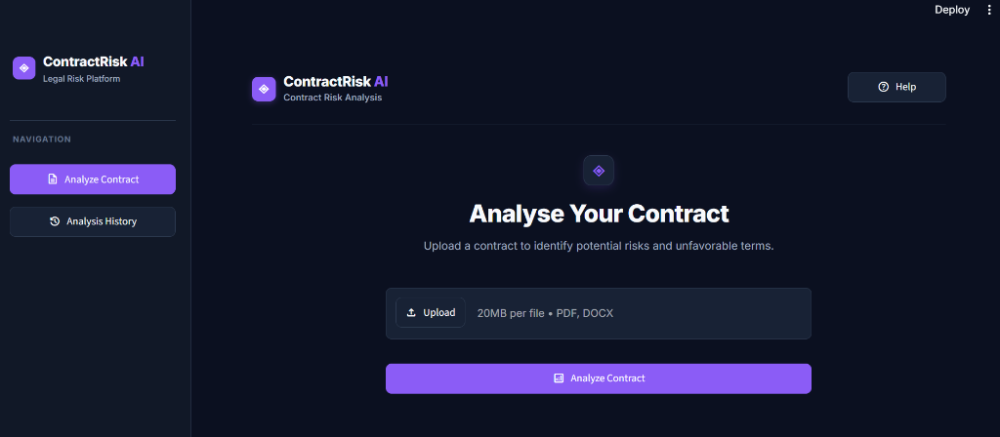
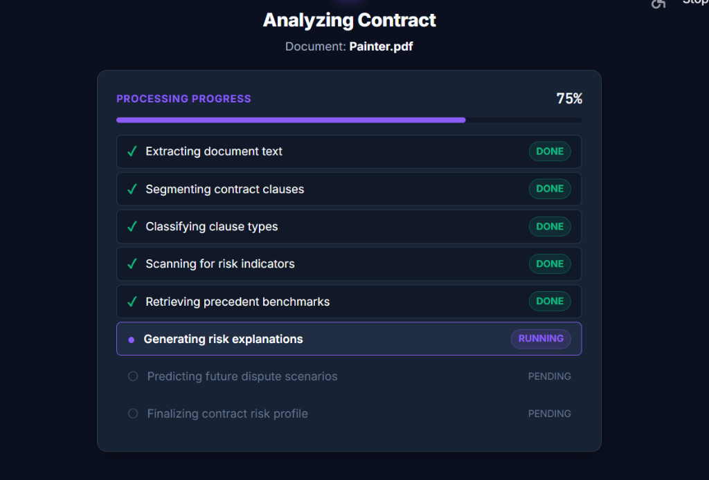
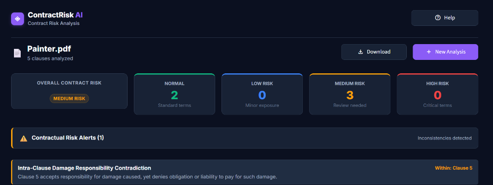
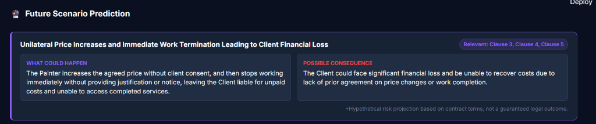
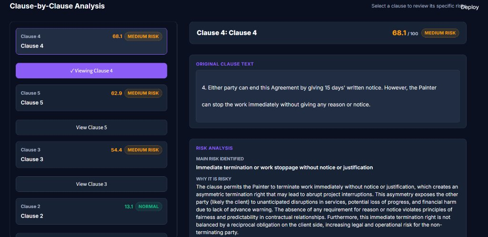

# ContractRisk AI

ContractRisk AI is an AI-powered contract risk analysis system designed to evaluate commercial legal agreements. The platform ingests uploaded PDF and DOCX contracts, extracts and segments individual clauses, and identifies potentially risky or unfavorable contractual terms. By combining supervised classification, heuristic hazard detection, and vector precedent retrieval with a local Qwen3 language model, ContractRisk AI delivers comprehensive clause-by-clause risk assessments, flags contractual inconsistencies, and forecasts plausible future dispute scenarios without exposing confidential legal data to external cloud APIs.

## Screenshots

### Landing Page

*Contract upload interface supporting PDF and DOCX documents up to 20 MB.*

### Processing Progress

*Contract analysis pipeline tracking execution across real-time processing stages.*

### Analysis Overview

*Overall contract risk score, risk distribution across categories, and contractual risk alerts.*

### Future Scenario Prediction

*Predicted risks, possible consequences, and relevant clauses generated by the local Qwen3 model.*

### Clause-by-Clause Analysis

*Individual clause risk score, extracted original text, and detailed plain-English risk explanation.*

## Tech Stack

| Technology | Purpose |
| :--- | :--- |
| **Python** | Core application programming language |
| **Streamlit** | Interactive dark legal-tech dashboard |
| **FastAPI** | RESTful backend API service for contract analysis |
| **PostgreSQL** | Relational database for persistent contract and clause storage |
| **SQLAlchemy** | Database ORM and schema management |
| **PyTorch** | Machine learning framework for local deep learning inference |
| **Hugging Face Transformers** | Supervised legal BERT classifier trained across 41 CUAD categories |
| **Sentence Transformers** | Dense vector representations for clauses (`all-MiniLM-L6-v2`) |
| **FAISS** | Fast vector similarity search over indexed benchmark precedents |
| **Qwen3 (via LM Studio)** | Local language model for risk explanations and dispute scenario prediction |
| **PyMuPDF** | Digital text and layout extraction from PDF agreements |
| **python-docx** | Structured text extraction from DOCX agreements |

## Workflow

1. **Contract Upload** — User uploads a PDF or DOCX contract.
2. **Text Extraction** — Extract contract text from the document.
3. **Clause Segmentation** — Divide the contract into individual clauses.
4. **Clause Classification** — Identify clause categories using the trained BERT model.
5. **Risk Analysis** — Evaluate clauses using the existing risk detection pipeline.
6. **Context Retrieval** — Retrieve relevant contractual examples using semantic search.
7. **AI Explanation** — Generate understandable risk explanations using the local Qwen3 model.
8. **Future Scenario Prediction** — Generate hypothetical future dispute scenarios based on relevant contract terms.
9. **Results** — Present the overall risk summary, detected inconsistencies, and clause-by-clause analysis.
