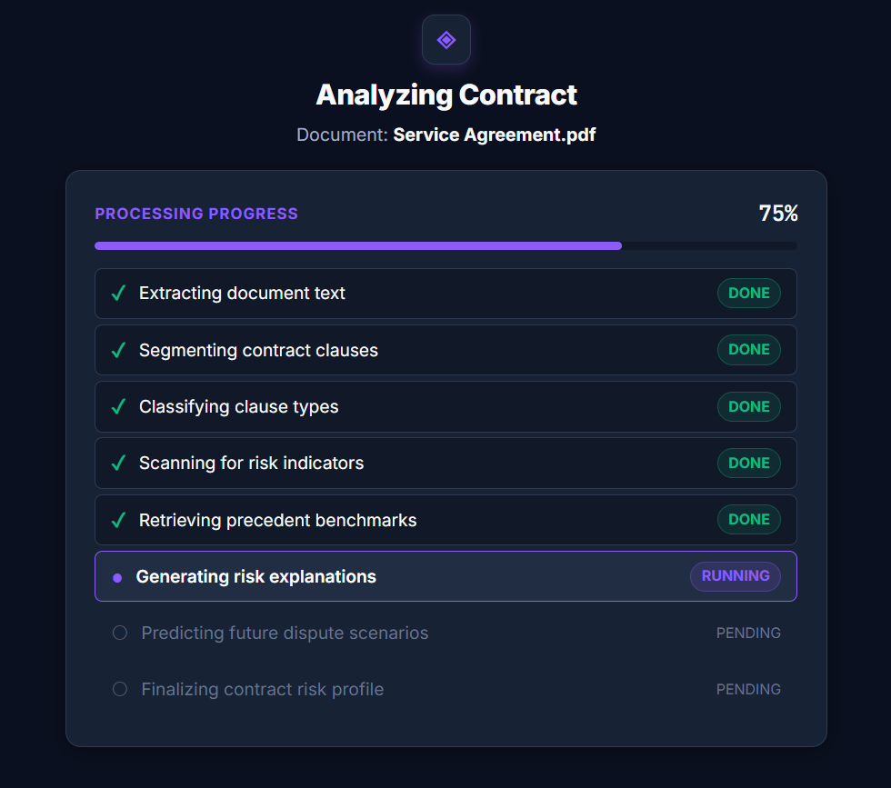
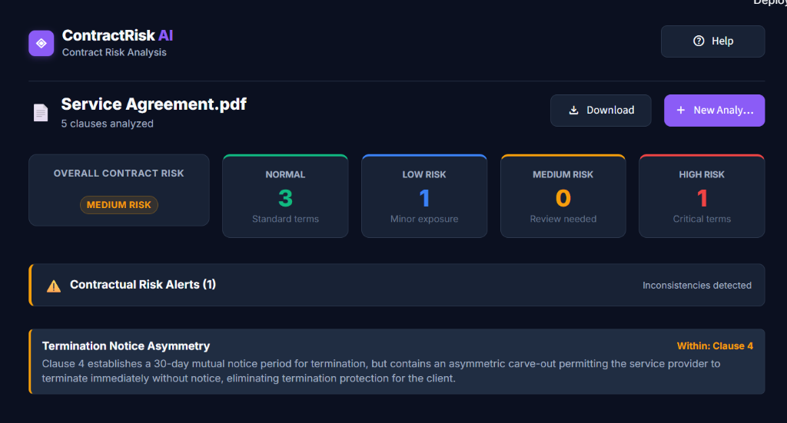
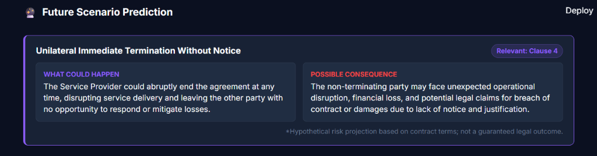

# ContractRisk AI

ContractRisk AI is an AI-powered contract risk analysis system designed to evaluate commercial legal agreements. The platform ingests uploaded PDF and DOCX contracts, extracts and segments individual clauses, and identifies potentially risky or unfavorable contractual terms. By combining supervised classification, heuristic hazard detection, and vector precedent retrieval with a local Qwen3 language model, ContractRisk AI delivers comprehensive clause-by-clause risk assessments, flags contractual inconsistencies, and forecasts plausible future dispute scenarios without exposing confidential legal data to external cloud APIs.

## Screenshots

### Contract Upload

*Minimal upload interface supporting PDF and DOCX documents up to 20 MB.*

### Contract Processing

*Real-time pipeline monitor tracking progress across extraction, segmentation, classification, and reasoning stages.*

### Risk Summary

*Overall contract risk score, distribution across risk categories, and contractual risk alerts.*

### Future Scenario Prediction

*Hypothetical dispute scenarios and operational consequences forecasted by the local Qwen3 model.*

### Clause-by-Clause Analysis

*Interactive clause review showing original contract text alongside plain-English risk assessments and unfavorable terms.*

## Tech Stack

| Category | Technologies |
|---|---|
| Language | Python 3.11 |
| NLP | spaCy, Transformers |
| Clause Classification | BERT (`bert-base-uncased`) |
| Embeddings | Sentence Transformers (`all-MiniLM-L6-v2`) |
| Vector Search | FAISS |
| RAG | LangChain |
| Local LLM | Qwen3 4B GGUF via LM Studio |
| Risk Analysis | Python Regex Rule Engine + Hybrid Scoring |
| Backend | FastAPI, Pydantic |
| Database | PostgreSQL, SQLAlchemy, Alembic |
| Frontend | Streamlit |
| Document Processing | PyMuPDF, python-docx |
| ML Framework | PyTorch |
| Hardware | NVIDIA RTX 3050 4GB GPU, 16GB RAM |
| Environment | Windows, Python virtual environment |

## Development Phases

1. **Environment Setup**: Configured Python 3.11, CUDA 11.8, PyTorch GPU acceleration, and LM Studio local runtime.
2. **Dataset Preparation & Validation**: Cleaned, normalized, and partitioned 9,447 contract clauses into deduplicated train, validation, and test splits.
3. **BERT Clause Classification**: Fine-tuned `bert-base-uncased` across 41 legal clause categories and evaluated classification performance.
4. **Document Processing**: Implemented robust text extraction and normalizers for PDF (PyMuPDF) and DOCX (python-docx) files.
5. **Clause Segmentation**: Developed structural boundary segmentation using spaCy to parse contracts into discrete numbered clauses.
6. **Embeddings & FAISS Retrieval**: Built semantic representations with `all-MiniLM-L6-v2` and constructed a FAISS similarity search index.
7. **RAG Integration & Local LLM**: Assembled contextual retrieval prompts and integrated local Qwen3 4B via LM Studio's OpenAI-compatible API.
8. **Hybrid Risk Analysis & Scoring**: Implemented the deterministic Regex Risk Engine (`src/risk_analysis/rules.py`, `rule_engine.py`), Future Scenario Predictor, and multi-factor scoring.
9. **PostgreSQL Persistence**: Designed relational SQLAlchemy models and Alembic migrations for contracts, clauses, risk scores, and scenario records.
10. **FastAPI Backend**: Exposed RESTful endpoints for contract ingestion, pipeline execution, document queries, and system health checks.
11. **Streamlit Frontend**: Built an intuitive 5-state single-workflow web interface for file upload, progress monitoring, and interactive report review.
12. **End-to-End Validation**: Validated the complete extraction, scoring, and persistence pipeline on full commercial agreement documents.
13. **Performance Optimization**: Profiled local inference and implemented tiered routing to bypass LLM calls for low-risk clauses, achieving ~26x speedup.
14. **System Evaluation**: Conducted regression testing (116 passing tests) and established quantitative benchmarking protocols.

## Machine Learning Results

### Dataset
- **Total Clauses**: 9,447
- **Classes**: 41 legal clause categories
- **Train Split**: 6,612 clauses (70%)
- **Validation Split**: 1,417 clauses (15%)
- **Test Split**: 1,418 clauses (15%)

### BERT Classifier Performance
- **Model**: `bert-base-uncased` (`Linear(768, 41)`)
- **Test Accuracy**: **71.86%**
- **Test Macro F1**: **0.5115**
- **Test Weighted F1**: **0.6977**

*These figures represent empirical held-out test-set results from the trained supervised classifier across 41 imbalanced legal clause classes.*

## Risk Scoring

### Clause Risk Score ($S_{\text{clause}} \in [0, 100]$)
$$S_{\text{clause}} = 0.30 \times S_{\text{BERT}} + 0.35 \times S_{\text{Rule}} + 0.15 \times S_{\text{RAG}} + 0.20 \times S_{\text{LLM}}$$

- $S_{\text{Rule}}$ uses asymptotic saturation: $S_{\text{Rule}} = 100 \times (1 - e^{-\sum \text{severity}})$.
- Risk Thresholds:
  - **LOW**: $< 35$
  - **MEDIUM**: $35 - 69.9$
  - **HIGH**: $\ge 70$

### Contract-Level Risk Score ($S_{\text{contract}} \in [0, 100]$)
$$S_{\text{contract}} = 0.60 \times \max(S_{\text{clause}}) + 0.40 \times \operatorname{mean}(S_{\text{clause}})$$

Balances peak catastrophic clause exposure with overall document risk profile.

## How It Works

1. **Upload**: User uploads a `.pdf` or `.docx` contract via the Streamlit interface.
2. **Text Extraction**: PyMuPDF or python-docx extracts raw text with document metadata.
3. **Segmentation**: spaCy segments text into discrete numbered clauses and standalone headings.
4. **Classification**: Fine-tuned BERT assigns a legal category and preliminary risk rating to each clause.
5. **Rule Matching**: Deterministic Regex Risk Engine evaluates clauses against compiled hazard patterns.
6. **Vector Search**: Sentence Transformers encodes clauses, and FAISS retrieves top-$k$ reference benchmarks.
7. **LLM Reasoning**: Risky clauses are routed to Qwen3 4B via LM Studio for risk explanation and scenario synthesis.
8. **Scenario Forecasting**: Future Scenario Predictor generates trigger conditions, consequences, assumptions, and uncertainties.
9. **Scoring**: Hybrid risk engine calculates calibrated 0–100 clause and contract scores.
10. **Persistence & Display**: Results are saved to PostgreSQL and rendered interactively in Streamlit.

## API

The FastAPI service exposes the following REST endpoints under `/api/v1`:

- `POST /api/v1/analyze`: Uploads contract, runs full analysis pipeline, persists records, and returns complete report.
- `GET /api/v1/health`: Checks service health, uptime status, and API version.
- `GET /api/v1/models`: Returns status of active BERT checkpoint, FAISS index, and local LLM runtime.
- `GET /api/v1/documents`: Returns paginated list of analyzed contracts from PostgreSQL.
- `GET /api/v1/documents/{document_id}`: Retrieves complete stored analysis record and clause breakdown by ID.

## Project Structure

```
AI CLAUSE ANALYSER/
├── alembic/                # Database migrations
├── data/                   # Contract datasets and splits (Git-ignored)
├── docs/                   # Technical documentation
├── frontend/               # Streamlit application and components
├── models/                 # Model checkpoints and FAISS index (Git-ignored)
├── notebooks/              # Research and EDA notebooks
├── scripts/                # Utility and verification scripts
├── src/                    # Core source code (API, DB, ML, RAG, Risk Analysis)
├── tests/                  # pytest test suite (116 passing tests)
├── .env.example            # Environment configuration template
├── requirements.txt        # Python dependencies
└── README.md               # Project documentation
```

## Setup

### Prerequisites
- Python 3.11 on Windows (CUDA-capable NVIDIA GPU recommended)
- PostgreSQL 15+ running locally
- LM Studio running locally with `Qwen3 4B Instruct GGUF (Q4_K_M)` loaded

### Local Installation
```powershell
# 1. Clone repository
git clone https://github.com/your-username/contract-risk-ai.git
cd contract-risk-ai

# 2. Create and activate virtual environment
python -m venv .venv
.\.venv\Scripts\Activate.ps1

# 3. Install dependencies
pip install -r requirements.txt

# 4. Configure environment variables
copy .env.example .env
# Edit .env with your local PostgreSQL credentials

# 5. Run database migrations
alembic upgrade head

# 6. Start LM Studio local server on port 1234

# 7. Start FastAPI backend (Terminal 1)
python -m uvicorn src.api.main:app --reload --host 127.0.0.1 --port 8000

# 8. Start Streamlit frontend (Terminal 2)
streamlit run frontend/app.py --server.port 8501
```

Access the application in your browser at `http://localhost:8501`.

*Note: Model binary checkpoints (`pytorch_model.bin`, ~438 MB), raw datasets, and local `.env` are excluded from Git tracking via `.gitignore`.*


## Disclaimer

ContractRisk AI is an automated decision-support research tool intended solely to assist human legal and compliance professionals. It is **not** a lawyer, law firm, or substitute for qualified legal counsel. The classifications, risk scores, and future scenarios produced by this system are heuristic and probabilistic estimates. No legal, financial, or contractual decisions should be made based solely on the outputs of this software.
